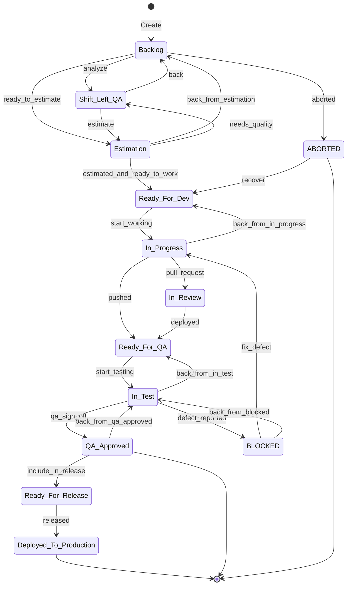
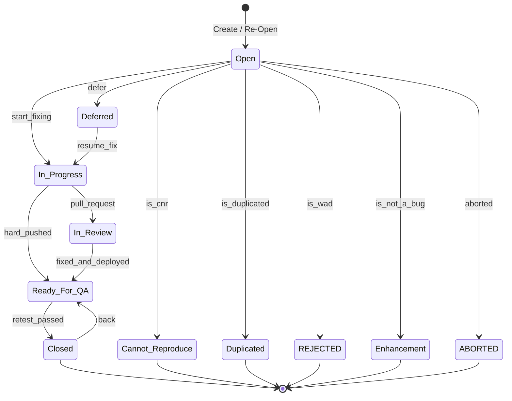
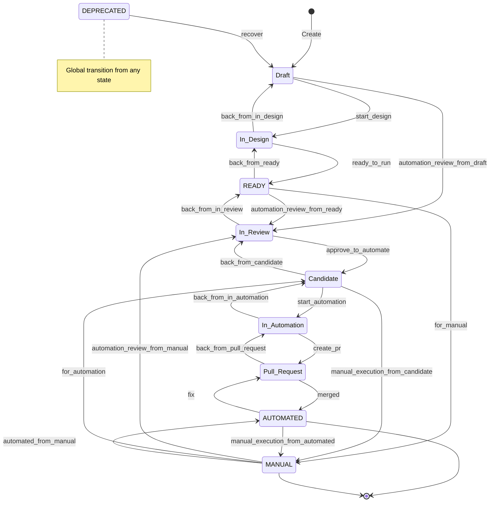

# Product Backlog Items (PBI) — Backlog Access Recipe

| Field | Value |
|---|---|
| **PM Tool** | Jira Cloud |
| **Project Key** | BK |
| **Access Method** | `/acli` CLI (primary) · Atlassian MCP (fallback) |
| **Last Updated** | 2026-05-31 |

---

## Backlog Location

| Field | Value |
|---|---|
| **URL** | https://upexgalaxy67.atlassian.net/ |
| **Project Key** | BK |
| **Workflow Scheme** | UPEX PROGRAM Workflow Scheme |
| **Board Name/Type** | Discovery Gap — board name not verified (see §Discovery Gaps) |

---

## Access Configuration

### Primary: `/acli` CLI Skill

Load the `/acli` skill before running any Jira commands.

```bash
# Verify access
acli jira issue list --project BK --jql "project = BK ORDER BY updated DESC" --limit 5
```

Setup steps:
1. Ensure `.env` contains all three required credential vars (see §Credentials)
2. Load `/acli` skill in the AI session
3. Verify with `acli jira issue list --project BK`

### Fallback: Atlassian MCP

Used when `acli` is unavailable or when rich schema-aware queries are needed.
Configured via `.mcp.json` — consumes the same `ATLASSIAN_URL`, `ATLASSIAN_EMAIL`, `ATLASSIAN_API_TOKEN` env vars.

### Required env vars

```
ATLASSIAN_URL=
ATLASSIAN_EMAIL=
ATLASSIAN_API_TOKEN=
```

These live in `.env` (never committed). Names are the single source of truth — no `JIRA_*` aliases.

---

## Project Structure

### Issue Types

| Issue Type | Jira ID | Workflow | Role |
|---|---|---|---|
| Story | 10005 | UPEX Feature (US) Workflow | User story / feature work item |
| Bug | 10107 | UPEX BUG/DEFECT LIFE CYCLE | Defect report |
| Test | 10100 | UPEX Test (TC) Workflow | Test case (used by TMS / Xray) |
| Epic | — | — | Feature theme / module container |

> Note: Epic, Task, and Sub-task presence not verified from create-meta — see §Discovery Gaps.

### Story Workflow



### Bug Workflow



### Test Case Workflow



### Sprint Cadence

Discovery Gap — sprint length, active sprint name, and cadence not verified from files. See §Discovery Gaps.

---

## Common Queries (JQL)

### 1. Current sprint ready for QA

```jql
project = BK AND sprint in openSprints() AND status = "Ready For QA" ORDER BY priority DESC
```

**acli equivalent:**
```bash
acli jira issue list --project BK --jql 'project = BK AND sprint in openSprints() AND status = "Ready For QA"'
```

### 2. All open bugs

```jql
project = BK AND issuetype = Bug AND resolution = Unresolved ORDER BY priority DESC
```

**acli equivalent:**
```bash
acli jira issue list --project BK --jql 'project = BK AND issuetype = Bug AND resolution = Unresolved ORDER BY priority DESC'
```

### 3. My testing tasks

```jql
project = BK AND status = "In Test" AND assignee = currentUser()
```

**acli equivalent:**
```bash
acli jira issue list --project BK --jql 'project = BK AND status = "In Test" AND assignee = currentUser()'
```

### 4. Recently updated

```jql
project = BK AND updated >= -1d ORDER BY updated DESC
```

**acli equivalent:**
```bash
acli jira issue list --project BK --jql 'project = BK AND updated >= -1d ORDER BY updated DESC'
```

---

## Integration with KATA

| Trigger | Action | Local Output |
|---|---|---|
| `/sprint-testing` starts | Fetch ticket by key via `acli jira issue get BK-XXX` | `.context/PBI/epics/EPIC-BK-*/stories/STORY-BK-XXX-*/` |
| Bug triage | Query open bugs JQL above | Review in Jira; file via `acli jira issue create` |
| `/test-documentation` | Fetch story + linked TCs | Update `acceptance_test_plan` / `acceptance_test_results` custom fields |
| `/test-automation` resume | Read PROGRESS.md + ROADMAP.md | No Jira fetch needed — local cache used |
| Automation handoff | Transition TC to `Candidate` or `In Automation` | `acli jira issue transition BK-XXX "start automation"` |
| Regression run | Query sprint stories in `QA Approved` or `In Test` | Cross-reference with Allure report |

### Local Storage Layout

```
.context/PBI/
+-- README.md                         permanent -- backlog access recipe + common queries (this file)
+-- templates/                        permanent -- format-reference guides only (NOT per-ticket targets)
|   +-- user-story.md                 format reference: role/action/benefit + AC skeleton
|   +-- bug-report.md                 format reference: severity guide + evidence block
|   `-- test-plan.md                  format reference: AC->TC mapping + scope + risks
`-- epics/                            synced from Jira by /sprint-testing -- read-only cache, NOT created here
    `-- EPIC-BK-100-<slug>/
        `-- stories/
            `-- STORY-BK-123-<slug>/
                `-- ...               materialized by `bun run jira:sync-issues get <KEY> --include-comments`
```

> The `epics/` tree is synced from Jira on demand by `/sprint-testing` (Module = Epic, 1:1).
> It is a read-only cache — Jira is the source of truth. This README and the `templates/` files
> are the ONLY Phase 4 outputs. Per-ticket content is never authored here.

---

## Credentials

Required env vars in `.env` (never commit this file):

```
ATLASSIAN_URL=          # e.g. https://upexgalaxy67.atlassian.net/
ATLASSIAN_EMAIL=        # Atlassian account email
ATLASSIAN_API_TOKEN=    # Generated at https://id.atlassian.com/manage-profile/security/api-tokens
```

**Rules:**
- No `JIRA_*` aliases. These three keys are the single source of truth.
- MCP, acli, xray-cli, and sync scripts all consume the same vars.
- If a credential error occurs mid-session, stop immediately, fix `.env`, and restart the agent session (env is cached at MCP-spawn time — no mid-session refresh).

---

## Discovery Gaps

| Gap | Impact | How to Resolve |
|---|---|---|
| Board name and type (Scrum vs Kanban) not verified | Sprint queries may need adjustment if board is Kanban | Run `acli jira board list --project BK` once credentials are active |
| Sprint cadence (length, current sprint name) not verified | Cannot confirm sprint naming convention | Check Jira board + run `acli jira sprint list --board <BOARD_ID>` |
| Epic and Task issue type IDs not confirmed from create-meta | Epic Link field usage may differ | Run `acli jira issue createmeta --project BK` to enumerate all types |
| Sub-task usage not confirmed | Sub-task hierarchy may exist under Stories | Verify by listing recent story children in Jira |
| Required custom fields for ticket creation not fully verified | CLI issue creation may fail without required fields | Run `bun run jira:check` to validate against `jira-required.yaml` |
