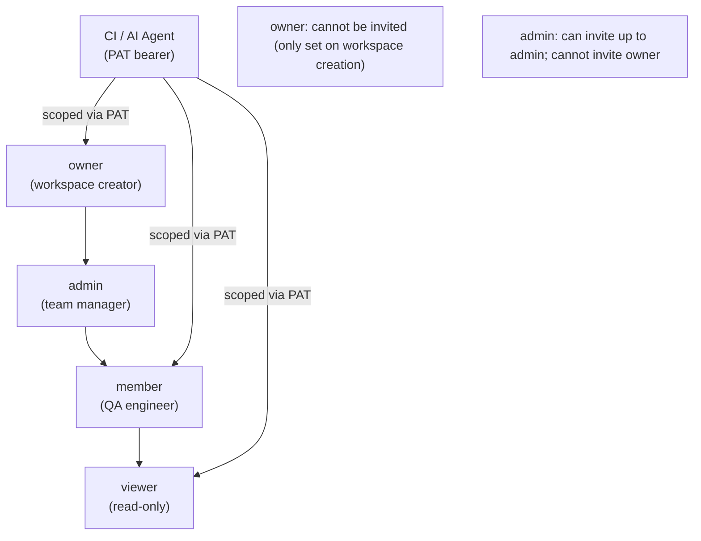

# PRD — User Personas

> Product: Bunkai TMS
> Phase: 2 — Architecture
> Generated: 2026-05-31
> Mindset: Personas = system roles the code recognizes. No demographic invention.

---

## 1. Persona Discovery Summary

| Persona | System Role | Access Level | Primary Goal |
|---------|-------------|-------------|-------------|
| Workspace Owner | `owner` | Full control, cannot be demoted via invite | Create workspace, set up projects, manage team |
| Workspace Admin | `admin` | All writes + team management | Invite teammates, manage invites and membership |
| QA Engineer | `member` | All writes except workspace admin ops | Author ATCs, link to stories and ACs, classify by layer |
| Viewer | `viewer` | Read-only across all entities | Review ATCs and test coverage without mutation rights |
| CI / AI Agent | headless `bearer` | Scoped via PAT (`atc:read`, `atc:write`, `run:execute`, `workspace:admin`) | Programmatic read/write of ATCs; future: post run results |

Source: `supabase/migrations/0001_tenancy.sql` (CHECK on `workspace_members.role`), `lib/types.ts:13`, `app/qa/qa-config.ts`

---

## 2. Persona: Workspace Owner

### Identity

| Attribute | Value |
|-----------|-------|
| System Role | `owner` |
| Evidence | `supabase/migrations/0001_tenancy.sql:36` — `role CHECK ('viewer','member','admin','owner')` |
| Access Level | Full — all writes, workspace delete, member management, cannot be removed except by themselves |
| Estimated % of Users | Low (~1 per workspace) |

### Goals (Inferred from Features)

| Goal | Supporting Feature | Route / Component |
|------|-------------------|-------------------|
| Create a workspace | Onboarding form creates workspace via `bunkai_bootstrap_workspace` RPC | `app/(app)/onboarding/onboarding-form.tsx` → `POST /api/v1/workspaces` |
| Rename workspace | PATCH endpoint allows name change (owner-only via RLS) | `app/api/v1/workspaces/[id]/route.ts:45–81` |
| Invite initial team | Invite form on Members page | `app/(app)/workspaces/[id]/members/members-client.tsx` → `POST /api/v1/workspaces/{id}/invites` |
| Set up first project | Navigate to projects after workspace creation | `app/(app)/projects/page.tsx` — redirects to first project or empty state |

### Pain Points (Inferred from Validation/Errors)

| Pain Point | Evidence |
|------------|----------|
| Slug taken on workspace creation | `"Slug \\"${slug}\\" is already taken."` — `app/api/v1/workspaces/route.ts:75` |
| Reserved slug rejection | `"Slug is reserved."` — `app/api/v1/workspaces/route.ts:51` |
| Invite link not emailed — must copy manually | `console.log` in `app/api/v1/workspaces/[id]/invites/route.ts:79` — no transactional email in MVP |

### Feature Access

| Feature | Access | Evidence |
|---------|--------|----------|
| Create workspace | Full | `bunkai_bootstrap_workspace` RPC, caller becomes owner |
| Rename workspace | Full (owner-only) | RLS UPDATE policy on `workspaces` — owner only |
| Invite teammates | Full | `POST /api/v1/workspaces/{id}/invites` — admin/owner gate |
| Revoke invites | Full | `DELETE /api/v1/workspaces/{id}/invites/{inviteId}` |
| Rotate invite tokens | Full | `POST /api/v1/workspaces/{id}/invites/{inviteId}` (resend) |
| Read ATCs | Full | RLS SELECT |
| Write ATCs | Full | RLS INSERT/UPDATE/DELETE |
| Issue PATs | Full | `POST /api/v1/tokens` — session-authenticated |

### User Journey Summary

```
Login → /auth/callback → /projects (redirect) → /onboarding (no workspace) → Create workspace → /projects → Create project* → Add module* → Add story → Add ATC
```
*Phase E feature not yet in UI

### Profile Attributes

| Attribute | Source |
|-----------|--------|
| `user_id` (UUID) | `auth.users` — Supabase Auth |
| `email` | `auth.users.email` — Supabase Auth |
| No display name / avatar table | `auth.users.raw_user_meta_data` only — no `profiles` table found |
| `workspace_members.role = 'owner'` | `supabase/migrations/0001_tenancy.sql` |
| `workspace_members.status = 'active'` | Set on workspace creation via RPC |

### Representative Quote (inferred)

> "I just need to spin up a workspace, get my team invited, and start mapping our stories to test cases. I don't need a 60-step enterprise setup."

---

## 3. Persona: Workspace Admin

### Identity

| Attribute | Value |
|-----------|-------|
| System Role | `admin` |
| Evidence | `supabase/migrations/0001_tenancy.sql:36`, `app/api/v1/workspaces/[id]/invites/route.ts:57` |
| Access Level | All writes + invite management; cannot delete workspace or rename it (owner-only) |
| Estimated % of Users | Low-medium (~1-3 per workspace) |

### Goals (Inferred from Features)

| Goal | Supporting Feature | Route / Component |
|------|-------------------|--------------------|
| Invite new team members | Invite form — email + role selection | `app/(app)/workspaces/[id]/members/members-client.tsx` |
| Monitor pending invites | Members page lists invites with derived status | `app/(app)/workspaces/[id]/members/page.tsx` |
| Revoke or resend invites | Invite management via REST | `DELETE /api/v1/workspaces/{id}/invites/{inviteId}` |

### Pain Points (Inferred from Validation/Errors)

| Pain Point | Evidence |
|------------|----------|
| Cannot invite someone as `owner` | Invite role schema excludes `owner` — `app/api/v1/workspaces/[id]/invites/route.ts:21` `z.enum(['viewer','member','admin'])` |
| Invite link must be copied and shared manually | No email sending in MVP — `app/api/v1/workspaces/[id]/invites/route.ts:79` `console.log` |
| Non-admin gets 403 attempting to invite | `"You must be an admin or owner to invite teammates."` — `app/api/v1/workspaces/[id]/invites/route.ts:58` |

### Feature Access

| Feature | Access | Evidence |
|---------|--------|----------|
| Invite members (viewer/member/admin) | Full | RLS gate: `admin` or `owner` |
| Revoke invites | Full | RLS on `workspace_invites` |
| Read ATCs / stories / modules | Full | RLS SELECT |
| Write ATCs / stories / modules | Full | RLS INSERT/UPDATE/DELETE |
| Rename workspace | None (owner-only) | `app/api/v1/workspaces/[id]/route.ts:66` RLS |
| Delete workspace | None | No DELETE endpoint found for workspaces |

### User Journey Summary

```
Login → /projects/{slug} → /workspaces/{id}/members → Invite form → POST /api/v1/workspaces/{id}/invites → Copy accept_url → Share link
```

### Representative Quote (inferred)

> "I need to get three new engineers onboarded to the workspace before the sprint starts — where's the invite link?"

---

## 4. Persona: QA Engineer (Member)

### Identity

| Attribute | Value |
|-----------|-------|
| System Role | `member` |
| Evidence | `supabase/migrations/0001_tenancy.sql:36`, `lib/types.ts:13` |
| Access Level | Full write on ATCs, stories, modules, ACs; no team management |
| Estimated % of Users | High (~majority of workspace users) |

### Goals (Inferred from Features)

| Goal | Supporting Feature | Route / Component |
|------|-------------------|--------------------|
| Author ATCs with steps and assertions | Monaco editor for steps (Markdown) + assertions (YAML) | `components/atcs/AtcEditor.tsx`, `components/atcs/StepEditor.tsx` |
| Anchor ATC to acceptance criteria | AnchoringPanel component — required before save | `components/atcs/AnchoringPanel.tsx` |
| Classify ATC by test layer | Layer chip selector (UI / API / Unit) | `components/atcs/AtcEditor.tsx:57 LAYERS` |
| Navigate hierarchy via explorer sidebar | Module tree sidebar with story/AC/ATC breakdown | `components/layout/Sidebar.tsx` |
| Search ATCs | Full-text search via GIN index on `atcs.tsv` | `supabase/migrations/0004_atcs.sql atcs_tsv_gin_idx` |
| Mint a PAT for CI access | Token creation form / `POST /api/v1/tokens` | `app/api/v1/tokens/route.ts` |

### Pain Points (Inferred from Validation/Errors)

| Pain Point | Evidence |
|------------|----------|
| Cannot save ATC without linking a story | `"Bind to a user story before saving."` — `app/(app)/projects/[projectSlug]/atcs/[atcId]/actions.ts:26` |
| Cannot save ATC without linking ≥1 AC | `"Bind at least one acceptance criterion."` — `actions.ts:29` |
| Title required | `"Title is required."` — `actions.ts:33` |
| PAT secret shown only once — must copy immediately | `"Store the PAT token now — it cannot be retrieved later."` — `app/api/v1/tokens/route.ts:92` |

### Feature Access

| Feature | Access | Evidence |
|---------|--------|----------|
| View ATCs / stories / modules | Full | RLS SELECT |
| Create / edit ATCs | Full | RLS INSERT/UPDATE |
| Delete ATCs | Full | RLS DELETE |
| Create / edit modules and stories | Full | RLS INSERT/UPDATE |
| Invite teammates | None (admin/owner only) | `app/api/v1/workspaces/[id]/invites/route.ts:57–59` |
| Rename workspace | None | owner-only RLS |
| Issue PATs | Full (session only) | `app/api/v1/tokens/route.ts:33` |

### User Journey Summary

```
Login → /projects/{slug} (ATC list + sidebar) → Click ATC or New ATC → /projects/{slug}/atcs/{id} → Edit title/layer/tags → Add steps (Markdown) → Add assertions (YAML) → Select story → Select ACs → Save
```

### Representative Quote (inferred)

> "I need the ATC tied to the AC — if I can't see why a test exists, I shouldn't be running it."

---

## 5. Persona: Viewer

### Identity

| Attribute | Value |
|-----------|-------|
| System Role | `viewer` |
| Evidence | `supabase/migrations/0001_tenancy.sql:36`, `lib/types.ts:13` |
| Access Level | SELECT only on all workspace-scoped tables (enforced by RLS) |
| Estimated % of Users | Low-medium (developers reviewing coverage, stakeholders) |

### Goals (Inferred from Features)

| Goal | Supporting Feature | Route / Component |
|------|-------------------|--------------------|
| Review ATC coverage | ATC list on project page | `app/(app)/projects/[projectSlug]/page.tsx` |
| Browse module hierarchy | Explorer sidebar | `components/layout/Sidebar.tsx` |

### Pain Points (Inferred from Validation/Errors)

| Pain Point | Evidence |
|------------|----------|
| Any mutation attempt returns implicit 403 | RLS mutation policies require `role in ('member','admin','owner')` — `supabase/migrations/0001_tenancy.sql` through 0012 |

### Feature Access

| Feature | Access | Evidence |
|---------|--------|----------|
| Read ATCs / stories / modules / ACs | Full | RLS SELECT for `viewer` |
| Create / edit / delete anything | None | RLS mutation policies exclude `viewer` |
| Issue PATs | Limited (can issue session PAT, but PAT with `atc:write` would be blocked by RLS) | `app/api/v1/tokens/route.ts` — PAT is session-issued; scope check happens at API level |

### Representative Quote (inferred)

> "I just need to see what's being tested and what the current status is."

---

## 6. Persona: CI / AI Agent

### Identity

| Attribute | Value |
|-----------|-------|
| Auth Method | Bearer PAT (`Authorization: Bearer bk_pat_<prefix>.<secret>`) |
| Evidence | `lib/api/middleware/bearer.ts`, `lib/api/pat.ts`, `app/qa/qa-config.ts` |
| Access Level | Determined by PAT scopes at mint time |
| Estimated % of Users | Low count, high API volume |

### Goals (Inferred from Features)

| Goal | Supporting Feature | Route / Component |
|------|-------------------|--------------------|
| Read ATCs for automation | `GET /api/v1/*` with `atc:read` scope | `lib/api/auth.ts requireAuth` + `requireBearerToken` |
| Write ATCs from pipeline | `POST /api/v1/*` with `atc:write` scope | `lib/api/auth.ts` |
| Introspect identity / active workspace | `GET /api/v1/me` — Bearer path | `app/api/v1/me/route.ts:44–58` |
| Provision headless user + token in one round trip | `POST /api/v1/auth/signup` returns `user + session + pat` | `app/api/v1/auth/signup/route.ts:61–88` |

### Pain Points (Inferred from Validation/Errors)

| Pain Point | Evidence |
|------------|----------|
| Token must be stored at mint time — not retrievable later | `"Store the PAT token now — it cannot be retrieved later."` — `app/api/v1/tokens/route.ts:92` |
| `run:execute` scope exists but no endpoints to use it | `app/qa/qa-config.ts` patScopes — Phase 2 feature |
| Missing Authorization header → uniform 401 (no detail leak) | `"Missing or invalid Authorization header."` — `lib/api/middleware/bearer.ts:32` |

### Feature Access

| Feature | Required Scope | Evidence |
|---------|---------------|----------|
| Read ATCs/stories/modules | `atc:read` | `app/qa/qa-config.ts` patScopes |
| Write ATCs | `atc:write` | `app/qa/qa-config.ts` patScopes |
| Post run results (future) | `run:execute` | `app/qa/qa-config.ts` patScopes — no endpoint yet |
| Workspace admin ops | `workspace:admin` | `app/qa/qa-config.ts` patScopes |

### User Journey Summary

```
POST /api/v1/auth/signup → receive {user, session, pat} → Bearer bk_pat_xxx.yyy → GET /api/v1/me → GET /api/v1/workspaces → read/write ATCs
```

---

## 7. Role Hierarchy



Source: `supabase/migrations/0001_tenancy.sql`, `app/api/v1/workspaces/[id]/invites/route.ts:21`

---

## 8. Permission Matrix

| Permission | viewer | member | admin | owner | CI/Agent (atc:read) | CI/Agent (atc:write) | CI/Agent (workspace:admin) |
|-----------|:------:|:------:|:-----:|:-----:|:------------------:|:-------------------:|:-------------------------:|
| Read ATCs / stories / modules | ✓ | ✓ | ✓ | ✓ | ✓ | ✓ | ✓ |
| Create / update ATCs | ✗ | ✓ | ✓ | ✓ | ✗ | ✓ | ✗ |
| Delete ATCs | ✗ | ✓ | ✓ | ✓ | ✗ | ✓ | ✗ |
| Create modules / stories / ACs | ✗ | ✓ | ✓ | ✓ | ✗ | ✓ | ✗ |
| Invite members | ✗ | ✗ | ✓ | ✓ | ✗ | ✗ | ✓ |
| Revoke / rotate invites | ✗ | ✗ | ✓ | ✓ | ✗ | ✗ | ✓ |
| Rename workspace | ✗ | ✗ | ✗ | ✓ | ✗ | ✗ | ✗ |
| Issue PAT (session only) | ✓ | ✓ | ✓ | ✓ | N/A | N/A | N/A |
| Revoke own PAT | ✓ | ✓ | ✓ | ✓ | N/A | N/A | N/A |
| Read workspace metadata | ✓ | ✓ | ✓ | ✓ | ✓ | ✓ | ✓ |

Source: `supabase/migrations/0001_tenancy.sql` RLS policies (all tables), `app/api/v1/workspaces/[id]/route.ts` PATCH (owner only), `app/api/v1/workspaces/[id]/invites/route.ts` (admin/owner only)

---

## 9. Discovery Gaps

| Gap | Why It Matters | Question to Ask |
|----|----------------|----------------|
| No `profiles` table — display name/avatar from `auth.users.raw_user_meta_data` only | Cannot show human-readable member names in UI | Is user profile (display name, avatar) planned? Where does it live? |
| `viewer` role behavior in UI not confirmed | UI may not prevent viewers from clicking edit buttons; only backend blocks mutations | Are there client-side role checks in the React components? |
| `owner` cannot be reassigned | No endpoint to transfer workspace ownership found | Is workspace ownership transfer planned? |
| QA bot provisioning email domain not enforced | `qa.bot@bunkai-test.dev` is documented in `qa-config.ts` but no domain validation found | Is the QA bot email a convention or enforced? |
| PAT workspace_id scope not verified at API layer | PAT can be workspace-scoped but no code was found enforcing that scoped PATs cannot access other workspaces | Does a workspace-scoped PAT enforce workspace isolation at the API layer? |

---

## 10. QA Relevance

### Test Account Requirements

| Persona | Test Account | Permissions Needed | .env Key |
|---------|-------------|-------------------|----------|
| Workspace Owner | Dedicated test owner email | `owner` role, active membership | `LOCAL_OWNER_EMAIL` / `STAGING_OWNER_EMAIL` (not yet defined — flag as gap) |
| Workspace Admin | Dedicated test admin email | `admin` role, active membership | `LOCAL_ADMIN_EMAIL` / `STAGING_ADMIN_EMAIL` (not yet defined) |
| QA Engineer | Demo QA bot | `member` role, active membership | `LOCAL_USER_EMAIL` / `STAGING_USER_EMAIL` — confirmed in `.env.example` via `app/qa/qa-config.ts` (`qa.bot@bunkai-test.dev`) |
| Viewer | Dedicated test viewer email | `viewer` role, active membership | `LOCAL_VIEWER_EMAIL` / `STAGING_VIEWER_EMAIL` (not yet defined) |
| CI / AI Agent | QA bot PAT | Scoped to minimum required scope | `LOCAL_USER_PAT` (provision via `POST /api/v1/auth/signup`) |

### Critical Persona Flows to Test

1. **Owner**: Create workspace → auto-enrolled as `owner` → invite admin
2. **Admin**: Accept invite → become `admin` → invite member → invite viewer
3. **Member**: Accept invite → create ATC with steps/assertions/AC → save
4. **Member**: Attempt to save ATC without AC → blocked
5. **Viewer**: Login → attempt POST ATC → expect 403 at API layer
6. **Agent**: `POST /api/v1/auth/signup` → get PAT → Bearer call to `GET /api/v1/me`

### Edge Cases by Persona

| Persona | Edge Case | Expected Behavior |
|---------|----------|-------------------|
| Owner | Try slug = "login" | 422 — "Slug is reserved." |
| Owner | Try slug already taken | 409 — "Slug is already taken." |
| Admin | Invite with role = "owner" | 422 — Zod enum rejects "owner" from invite body |
| Member | Accept expired invite (>7 days) | 409 — "Invite has expired." |
| Member | Accept already-accepted invite | 409 — "Invite has already been accepted." |
| Member | Accept invite sent to different email | 403 — "This invite was sent to a different email address." |
| Agent | Use revoked PAT | 401 — "Invalid token." (uniform, no detail leak) |
| Agent | Use PAT with `atc:read` against write endpoint | 403 — "Token missing required scope: atc:write" |
