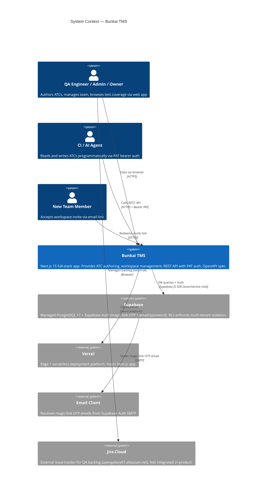
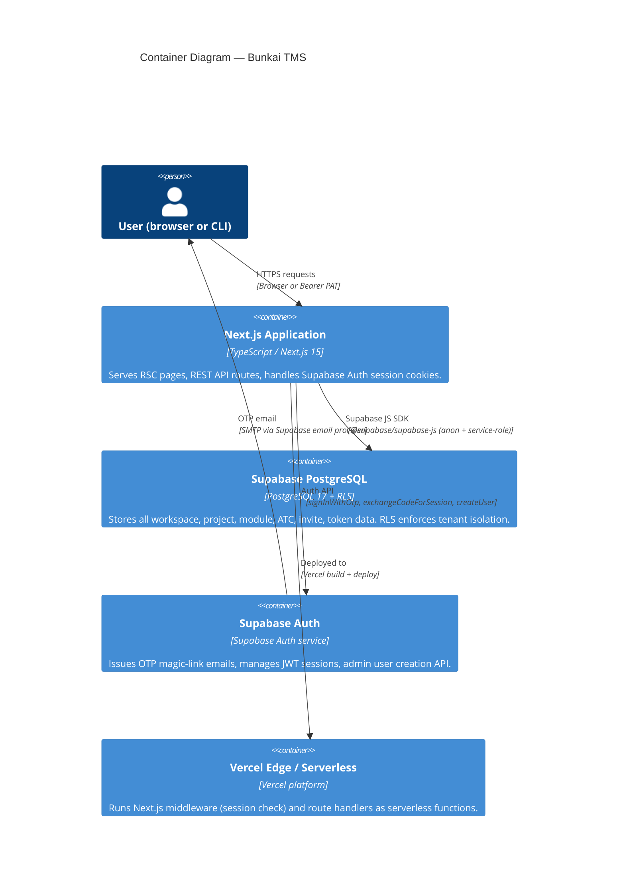
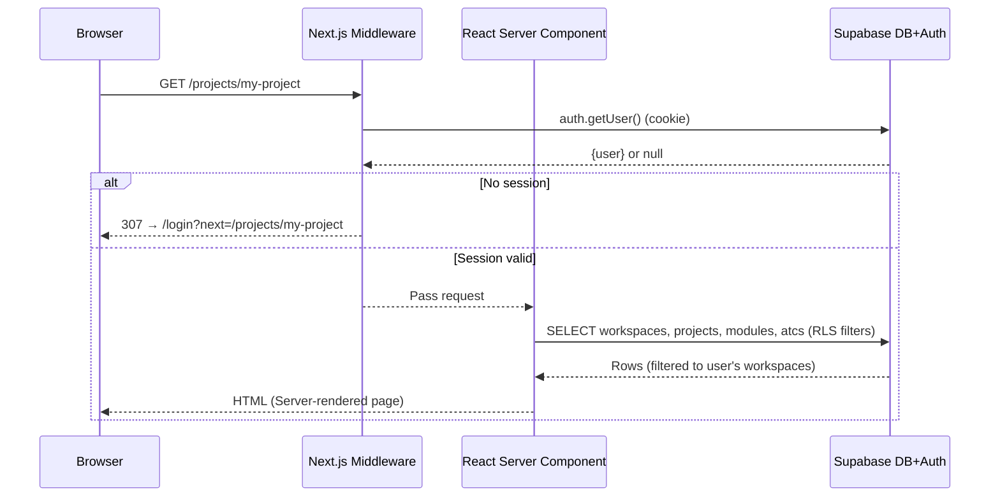
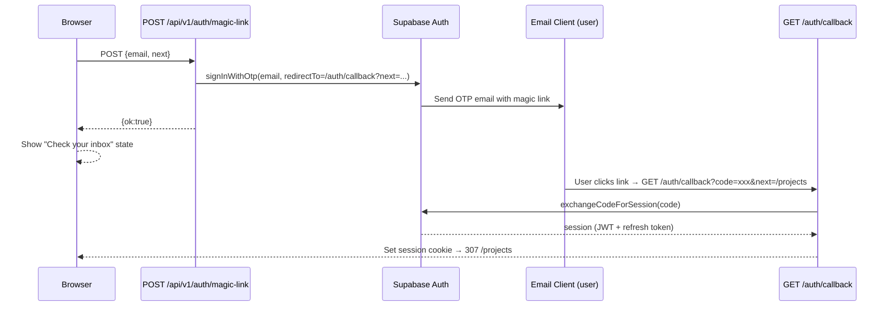
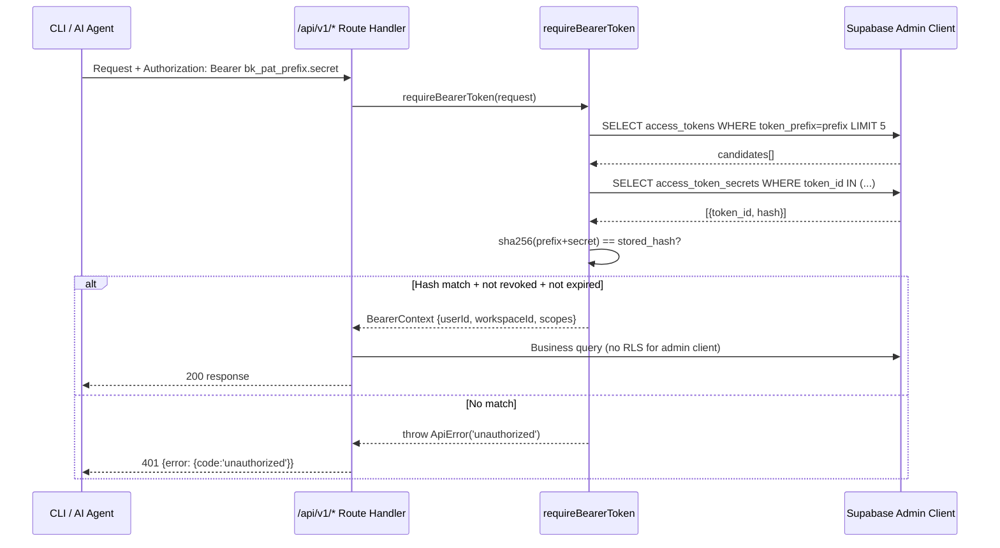

# SRS — Architecture Specs

> Product: Bunkai TMS
> Phase: 2 — Architecture
> Generated: 2026-05-31
> Source of truth: migrations + route handlers + lib/ files

---

## 1. System Overview

Bunkai TMS is a **Next.js 15 full-stack monorepo** following the server-component-first App Router pattern. There is no separate backend service — API routes (`app/api/v1/*`) and React Server Components share the same Next.js process. Supabase serves as the database, auth provider, and RLS enforcement layer. Vercel provides the deployment platform.

**Architecture pattern**: Next.js full-stack = React Server Components (data fetching, no round-trip) + Route Handlers (REST API) + Supabase RLS (authorization enforcement at DB layer) + Supabase Auth (identity).

| Layer | Technology | Version | Source |
|-------|-----------|---------|--------|
| Frontend framework | Next.js App Router | ^15 | `package.json` |
| React | React 19 | ^19 | `package.json` |
| Language | TypeScript (strict) | ^5.9.3 | `tsconfig.json` |
| Styling | Tailwind CSS + shadcn/ui | ^3.4 | `package.json` |
| Database | PostgreSQL 17 (Supabase managed) | — | `supabase/migrations/` |
| Auth | Supabase Auth | `@supabase/supabase-js ^2.106.0` | `package.json` |
| Deployment | Vercel | — | `.agents/project.yaml` |
| Runtime | Bun | >=1.0.0 | `package.json` |

---

## 2. C4 Context Diagram



---

## 3. C4 Container Diagram



---

## 4. Component Structure

### Directory Layout

```
upex-bunkai-tms/
├── app/                         # Next.js App Router
│   ├── (app)/                   # Authenticated route group (AuthProvider)
│   │   ├── layout.tsx           # AuthProvider wrapper
│   │   ├── onboarding/          # First-time workspace creation
│   │   ├── projects/            # Project listing + redirect logic
│   │   │   └── [projectSlug]/   # Project ATC list + ATC editor
│   │   └── workspaces/[id]/     # Workspace member management
│   ├── (auth)/                  # Unauthenticated route group
│   │   └── login/               # Magic-link form
│   ├── api/
│   │   ├── docs/                # Scalar UI page
│   │   ├── openapi/             # Static OpenAPI JSON serving
│   │   └── v1/                  # REST API surface
│   │       ├── auth/            # signup, signin, magic-link
│   │       ├── health/          # Liveness probe
│   │       ├── invites/accept/  # Invite redemption
│   │       ├── me/              # Principal introspection
│   │       ├── tokens/          # PAT CRUD
│   │       └── workspaces/      # Workspace CRUD + invite management
│   ├── auth/callback/           # OTP exchange handler
│   ├── invites/accept/          # Invite redemption page (public)
│   └── qa/                      # QA developer guide page + config
├── components/
│   ├── atcs/                    # ATC-specific components
│   │   ├── AtcEditor.tsx        # Full ATC editor (Monaco, anchoring)
│   │   ├── AtcTable.tsx         # TanStack Table ATC list
│   │   ├── AnchoringPanel.tsx   # Story/AC selector (anchoring moat)
│   │   └── StepEditor.tsx       # Monaco editor for steps/assertions
│   ├── layout/                  # App shell
│   │   ├── Sidebar.tsx          # Module tree explorer
│   │   ├── Topbar.tsx           # Top navigation + breadcrumbs
│   │   ├── CommandPalette.tsx   # cmdk command palette
│   │   └── WorkspaceSwitcher.tsx# Workspace context switcher
│   ├── providers/
│   │   └── auth-context.tsx     # Auth state context provider
│   └── ui/                      # shadcn/ui primitives (button, input, badge…)
├── lib/
│   ├── api/
│   │   ├── auth.ts              # Dual-mode auth (cookie OR bearer)
│   │   ├── error-envelope.ts    # ApiError class + error codes
│   │   ├── handler.ts           # withApiHandler wrapper (logging, error mapping)
│   │   ├── idempotency.ts       # Idempotency-Key header middleware
│   │   ├── invite-tokens.ts     # Invite token generation + hashing
│   │   ├── logging.ts           # Structured JSON logger (Vercel stdout)
│   │   ├── middleware/bearer.ts # PAT bearer token verification
│   │   ├── pat.ts               # PAT minting helper (shared)
│   │   ├── request-id.ts        # x-request-id propagation
│   │   └── workspace-cookie.ts  # bk_active_ws cookie helpers
│   ├── openapi/registry.ts      # zod-to-openapi registry + document builder
│   ├── supabase/
│   │   ├── admin.ts             # Service-role Supabase client
│   │   ├── client.ts            # Browser Supabase client
│   │   ├── server.ts            # Server-side Supabase client (SSR cookies)
│   │   ├── rpc.ts               # Typed RPC wrappers (bunkai_bootstrap_workspace, bunkai_save_atc)
│   │   └── with-workspace.ts    # Workspace-scoped query helper
│   ├── types/
│   │   ├── index.ts (lib/types.ts) # TypeScript entity types + enums
│   │   └── supabase.ts          # Generated Supabase DB types
│   ├── atc-parse.ts             # Markdown steps + YAML assertions parser
│   ├── env.ts                   # Env var validation (Zod schema)
│   ├── tree.ts                  # Module tree builder (flat → nested)
│   └── urls.ts                  # App URL constants by environment
├── supabase/migrations/         # 12 authoritative migration files
├── public/openapi.json          # Built OpenAPI spec (regenerate: bun run openapi:gen)
└── middleware.ts                # Next.js edge middleware (session + route protection)
```

### Component Responsibility Table

| Component | Responsibility |
|-----------|---------------|
| `middleware.ts` | Checks Supabase session, redirects unauthenticated users away from `PROTECTED_PREFIXES` |
| `lib/api/handler.ts` | `withApiHandler` — wraps all route handlers: request-id, structured logging, error mapping (ApiError → envelope, ZodError → 422) |
| `lib/api/auth.ts` | `requireAuth` — dual-mode auth: Bearer PAT OR cookie session |
| `lib/api/middleware/bearer.ts` | PAT verification: prefix lookup, SHA-256 hash compare, expiry/revocation check |
| `lib/api/idempotency.ts` | `Idempotency-Key` header support — lookup, replay detection, result recording |
| `lib/supabase/rpc.ts` | Typed wrappers for `bunkai_bootstrap_workspace` and `bunkai_save_atc` Supabase RPCs |
| `lib/tree.ts` | Pure function: flat `Module[]` + `UserStory[]` + `Atc[]` → nested `ModuleTreeNode[]` |
| `lib/openapi/registry.ts` | OpenAPI registry + document builder using `zod-to-openapi` |
| `components/atcs/AtcEditor.tsx` | Full ATC editing UI — Monaco editors, layer/tag selection, save flow |
| `components/atcs/AnchoringPanel.tsx` | Story + AC selector enforcing the anchoring moat constraint |

---

## 5. Database Schema

See `domain-glossary.md §4` for the full ER diagram. This section adds index and constraint detail.

### Table Summary

| Table | Rows Estimated | Key Indexes | Key Constraints |
|-------|---------------|-------------|----------------|
| `workspaces` | Low | `workspaces_slug_key` (UNIQUE) | `plan` CHECK (`community`,`cloud`,`enterprise`) |
| `workspace_members` | Low-medium | PK `(workspace_id, user_id)` | `role` CHECK, `status` CHECK |
| `workspace_invites` | Low | — | `expires_at` DEFAULT `now()+7d` |
| `workspace_invite_secrets` | Low | `workspace_invite_secrets_pkey` (token_id) | FK → `workspace_invites` ON DELETE CASCADE |
| `projects` | Low | PK `id`, `workspace_id` | `slug` unique per workspace (implicit) |
| `modules` | Medium | PK `id`, `project_id` | `modules_path_depth_max_6` CHECK, `path` UNIQUE per project |
| `user_stories` | Medium | PK `id`, `module_id` | FK `module_id` ON DELETE CASCADE |
| `acceptance_criteria` | Medium-high | PK `id`, `user_story_id` | `position` UNIQUE per story |
| `atcs` | High | PK `id`, `project_id`, `module_id`, `user_story_id`; `atcs_tsv_gin_idx` (GIN on `tsv`) | `layer` CHECK (`UI`,`API`,`Unit`), `status` CHECK (6 values), `slug` UNIQUE per project |
| `atc_steps` | High | PK `id`, `atc_id` | `position` UNIQUE per ATC |
| `atc_assertions` | High | PK `id`, `atc_id` | `position` UNIQUE per ATC |
| `atc_acceptance_criteria` | High | PK `(atc_id, acceptance_criterion_id)` | Composite FK |
| `access_tokens` | Low | `token_prefix` indexed | `scopes` CHECK (allowed scope set) |
| `access_token_secrets` | Low | PK `token_id` | FK → `access_tokens` ON DELETE CASCADE |
| `idempotency_keys` | Medium | UNIQUE `(user_id, endpoint, key)` | `status` CHECK |
| `activity_log` | High (over time) | — | `workspace_id` FK |
| `feature_flags` | Low | — | `scope` CHECK (`global`,`workspace`) |
| `magic_link_tokens` | Medium | — | — |
| `magic_link_token_secrets` | Medium | PK `magic_link_token_id` | FK ON DELETE CASCADE |

Source: `supabase/migrations/0001–0012`

### Key Indexes Detail

| Index | Table | Type | Purpose |
|-------|-------|------|---------|
| `atcs_tsv_gin_idx` | `atcs` | GIN | Full-text search on `tsv` tsvector (title + tags) |
| `workspaces_slug_key` | `workspaces` | UNIQUE B-tree | Globally unique workspace slug |
| `(workspace_id, user_id)` PK | `workspace_members` | B-tree | RLS policy primary lookup |
| `token_prefix` | `access_tokens` | B-tree | O(1) prefix lookup before hash compare |

Source: `supabase/migrations/0004_atcs.sql`, `supabase/migrations/0001_tenancy.sql`, `supabase/migrations/0008_access_tokens.sql`

---

## 6. Data Flow

### Request Sequence (Browser — Cookie Auth)



### Auth Sequence (Magic-Link)



### Auth Sequence (Bearer PAT)



---

## 7. External Services

| Service | Role | Integration Point | Auth Method |
|---------|------|------------------|-------------|
| Supabase (DB) | PostgreSQL 17 database — stores all product data | `lib/supabase/server.ts`, `lib/supabase/admin.ts` | `NEXT_PUBLIC_SUPABASE_ANON_KEY` (RLS) + `SUPABASE_SERVICE_ROLE_KEY` (admin) |
| Supabase Auth | Magic-link OTP + email/password auth + JWT session | `lib/supabase/server.ts` `auth.signInWithOtp`, `auth.admin.createUser` | Part of Supabase project (same credentials) |
| Vercel | Deployment platform — hosts Next.js app as serverless functions + edge | `.agents/project.yaml` `webapp_domain` | Vercel CLI / GitHub integration |
| Resend (unconfirmed) | Email delivery for transactional emails — NOT yet wired for invites in MVP | MVP uses `console.log` for invite URL; Resend is installed in QA boilerplate | N/A (not confirmed in target repo `package.json`) |

Source: `lib/env.ts`, `package.json`, `app/api/v1/workspaces/[id]/invites/route.ts:79`

---

## 8. Security Architecture

### Authentication

| Method | Flow | Implementation |
|--------|------|---------------|
| Magic-link (primary) | `signInWithOtp` → OTP email → `/auth/callback?code=` → `exchangeCodeForSession` → session cookie | `app/api/v1/auth/magic-link/route.ts`, `app/auth/callback/route.ts` |
| Email/password (headless) | `signInWithPassword` → session cookie + PAT returned | `app/api/v1/auth/signin/route.ts` |
| PAT bearer (API/CI) | `Authorization: Bearer bk_pat_<prefix>.<secret>` → prefix lookup → SHA-256 hash compare | `lib/api/middleware/bearer.ts` |

### Authorization

| Layer | Mechanism | Implementation |
|-------|-----------|---------------|
| Route protection | Next.js middleware: `PROTECTED_PREFIXES` check + Supabase `auth.getUser()` | `middleware.ts:8–52` |
| API authorization | `requireAuth` — dual-mode: Bearer → `requireBearerToken`; cookie → Supabase `auth.getUser()` | `lib/api/auth.ts` |
| PAT scope gating | `requireScope(ctx, scope)` — Bearer only; cookie sessions bypass (RLS is the gate) | `lib/api/middleware/bearer.ts:115–119` |
| Data isolation | Supabase RLS on all tables — all mutation policies require `workspace_members.role in ('member','admin','owner')` | `supabase/migrations/0001–0012` |
| Admin-only operations | `createAdminClient()` (service-role) used for cross-tenant ops (invite accept, token secrets) | `lib/supabase/admin.ts` |

### Secret Handling

| Secret | Storage | Separation |
|--------|---------|-----------|
| PAT secret | SHA-256 hash in `access_token_secrets` — QA roles revoked from reading this table | `supabase/migrations/0011_split_token_secrets.sql` |
| Invite token | SHA-256 hash in `workspace_invite_secrets` — same revocation | `supabase/migrations/0011_split_token_secrets.sql` |
| Magic-link token | SHA-256 hash + IP hash in `magic_link_token_secrets` — same revocation | `supabase/migrations/0011_split_token_secrets.sql` |
| Supabase service role key | `SUPABASE_SERVICE_ROLE_KEY` env var — validated at startup, `server-only` import guard | `lib/env.ts:22`, `lib/supabase/admin.ts` |

### HTTP Security

| Aspect | Status | Evidence |
|--------|--------|----------|
| Security headers (CSP, HSTS, X-Frame-Options) | NOT configured — `next.config.ts` has no `headers()` function | `next.config.ts` — no headers config |
| HTTPS | Enforced by Vercel (automatic TLS) | Vercel platform behavior |
| Open-redirect guard | Implemented — `/auth/callback` validates `next` is root-relative | `app/auth/callback/route.ts:17–19` |
| `x-request-id` header | Set on every API response | `lib/api/handler.ts:43` |
| Idempotency-Key support | Implemented for POST operations | `lib/api/idempotency.ts` |

---

## 9. Performance Hooks

| Aspect | Implementation | Evidence |
|--------|---------------|----------|
| GIN full-text search | `atcs.tsv` tsvector column with GIN index — `atcs_tsv_gin_idx` | `supabase/migrations/0004_atcs.sql` |
| `force-dynamic` on `/api/v1/me` | Prevents stale caching of auth state | `app/api/v1/me/route.ts:19` |
| `force-static` on `/api/openapi` | OpenAPI spec served from static file — cached 5 minutes (`max-age=300`) | `app/api/openapi/route.ts:14,22` |
| Monaco editor lazy-loaded | `next/dynamic` with `ssr: false` — prevents SSR for heavy editor | `components/atcs/AtcEditor.tsx:16–26` |
| Server Components data fetching | All project/module/ATC data fetched server-side via RSC — no client round-trip | `app/(app)/projects/[projectSlug]/page.tsx` |
| PAT prefix index | `token_prefix` indexed for O(1) candidate lookup before hash compare | `supabase/migrations/0008_access_tokens.sql` |
| Rate limiting | NOT implemented at middleware level — Supabase upstream passthrough only | `app/api/v1/auth/magic-link/route.ts:44–50` comment: "Phase F adds real rate-limit" |

---

## 10. API Contract Source

OpenAPI spec is **present and generated**:
- Static JSON file: `public/openapi.json` — version `0.1.0`, generated via `bun run openapi:gen`
- Served at runtime: `GET /api/openapi` — cached 5 minutes
- Scalar UI: `GET /api/docs`

**Status**: The spec covers Auth, Health, and Tokens tags but does NOT yet include Workspaces, Invites, or Me endpoints (registry in `lib/openapi/registry.ts` only registers shared components and the three listed tags).

For the full API contract (auth flow + critical endpoints + business context), run `/business-api-map` post-discovery. For automated test type generation, run `bun run api:sync` against the running spec URL.

Source: `app/api/openapi/route.ts:1–26`, `lib/openapi/registry.ts:86–108`, `public/openapi.json:1–39`

---

## 11. Discovery Gaps

| Gap | Impact | Suggested Source |
|----|--------|-----------------|
| No HTTP security headers configured | CSP, HSTS, X-Frame-Options absent — potential XSS/clickjacking surface | Add `headers()` to `next.config.ts`; run OWASP ZAP |
| Rate limiting is Supabase passthrough only | `/api/v1/auth/magic-link` can be abused for email spam | Implement Upstash Redis rate-limit middleware (comment in magic-link route says "Phase F") |
| No CI/CD pipeline in target repo | No automated builds, type-checks, or test runs on push | Set up GitHub Actions workflow |
| Supabase connection pool size unknown | Cannot estimate DB concurrency ceiling | Query Supabase project settings or `pg_stat_activity` via DBHub MCP |
| OpenAPI spec does not cover all endpoints | Workspaces, Invites, Me, Me/active-workspace endpoints are missing from spec | Run `bun run openapi:gen` after adding `.route.openapi.ts` siblings for missing routes |
| No Supabase project ref for staging | Cannot fully configure DBHub MCP | Request from team (needed for `DBHUB_USER` suffix) |

---

## 12. QA Relevance

### Components to Test

| Component | Test Priority | Approach |
|-----------|-------------|----------|
| `lib/api/middleware/bearer.ts` | P0 | API tests: valid PAT → 200, revoked → 401, wrong scope → 403, expired → 401 |
| `lib/api/idempotency.ts` | P1 | API tests: same Idempotency-Key + same payload → replay; same key + different payload → 409 |
| `lib/api/auth.ts` `requireAuth` | P0 | Verify Bearer shadows stale cookie correctly |
| `lib/tree.ts` | P1 | Unit test: flat modules → correct nested tree; parent_id null → root nodes |
| `middleware.ts` | P0 | E2E: unauthenticated access to `/projects` → redirect; authenticated → pass |
| `supabase RLS policies` | P0 | DB-level: cross-tenant SELECT returns 0 rows; viewer role INSERT rejected |

### Environment Requirements

| Requirement | Notes |
|------------|-------|
| Staging Supabase project | Required for E2E tests against `/api/v1/*` |
| `SUPABASE_SERVICE_ROLE_KEY` set | Required for headless user provisioning via `POST /api/v1/auth/signup` |
| `NEXT_PUBLIC_SUPABASE_URL` + `NEXT_PUBLIC_SUPABASE_ANON_KEY` | Required for browser client + middleware auth |
| DBHub MCP credentials | Required for DB-level RLS validation tests |
