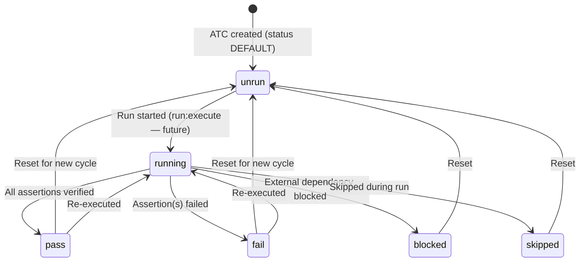
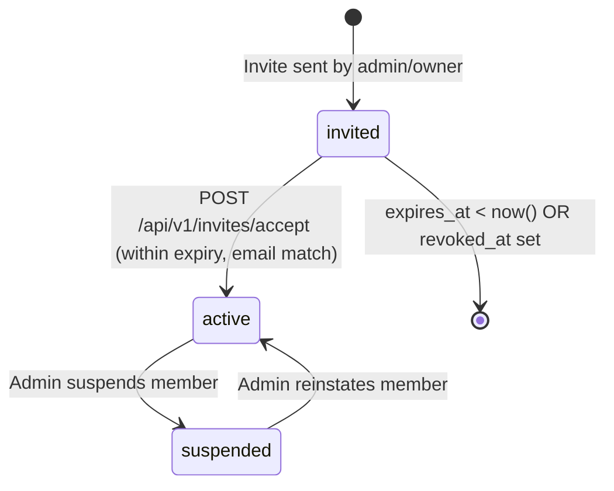
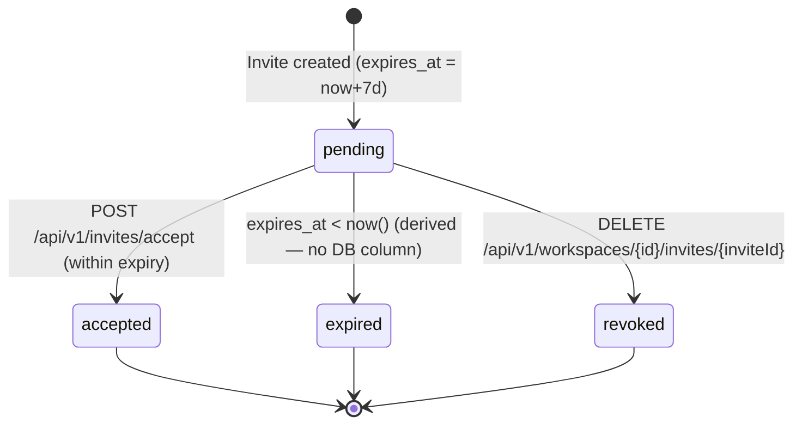
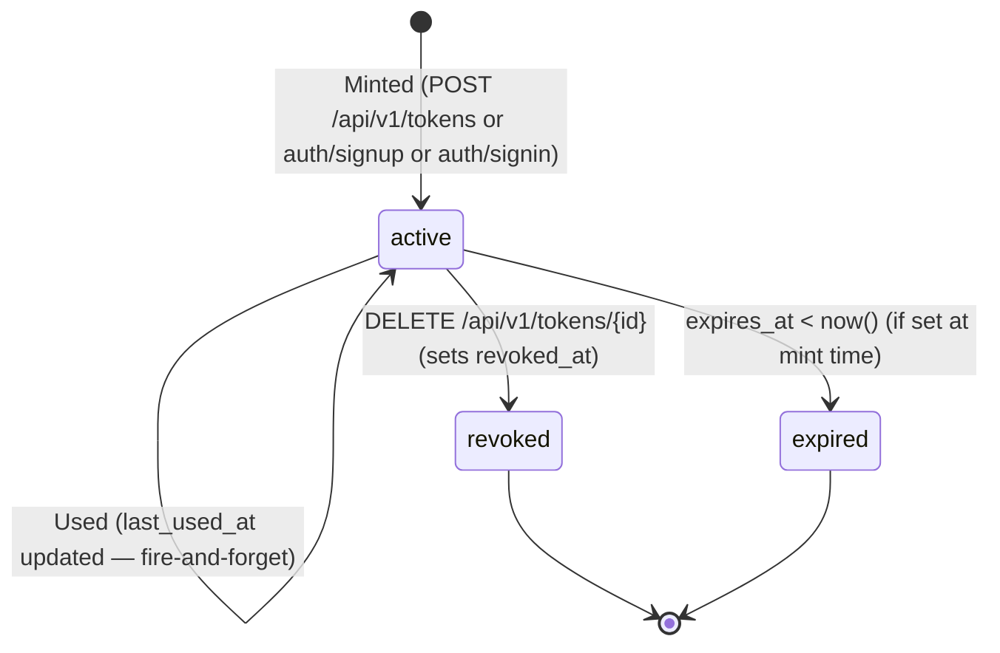
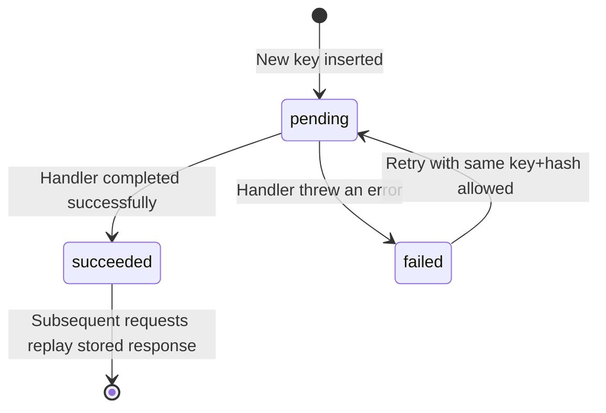

# SRS — Functional Specifications

> Product: Bunkai TMS
> Phase: 2 — Architecture
> Generated: 2026-05-31
> Coverage: Top 7 critical flows — auth, workspace CRUD, workspace invite lifecycle, PAT lifecycle, ATC save, user introspection, idempotency.

---

## 1. Specification Index

| ID | Feature | Category | Priority |
|----|---------|----------|---------|
| FR-001 | Magic-link authentication (send + OTP exchange) | Auth | P0 |
| FR-002 | Headless user provisioning (signup + PAT mint) | Auth | P0 |
| FR-003 | Headless sign-in (email/password + PAT mint) | Auth | P0 |
| FR-004 | Workspace creation (onboarding) | Workspace | P0 |
| FR-005 | Workspace invite lifecycle (send, accept, revoke, rotate) | Workspace | P1 |
| FR-006 | Personal Access Token (PAT) lifecycle (mint, list, revoke) | PAT | P0 |
| FR-007 | ATC save (atomic RPC — title, layer, tags, steps, assertions, AC anchoring) | ATC | P0 |
| FR-008 | Principal introspection (GET /api/v1/me) | User | P1 |
| FR-009 | Active workspace selection | User | P2 |
| FR-010 | Idempotency-Key middleware | Infrastructure | P1 |

---

## 2. FR-001: Magic-Link Authentication

| Aspect | Value |
|--------|-------|
| Feature | Magic-link send + OTP exchange |
| Related PRD | User Journeys §Journey 1 |
| Handler | `app/api/v1/auth/magic-link/route.ts` (POST); `app/auth/callback/route.ts` (GET) |
| Evidence | `app/api/v1/auth/magic-link/route.ts:28–62`, `app/auth/callback/route.ts:12–33` |

**Functional Requirement:** The system must accept an email address, send a Supabase OTP magic-link email with a post-redirect target, and exchange the returned OTP code for a session cookie.

**Input Specification — POST /api/v1/auth/magic-link**

| Field | Type | Required | Constraints |
|-------|------|----------|------------|
| `email` | string | Yes | Valid email format, max 254 chars |
| `next` | string | No | Root-relative path (`/...`, not `//...`), min 1 char |

Source: `app/api/v1/auth/magic-link/route.ts:14–26`

**Input Specification — GET /auth/callback**

| Parameter | Type | Required | Constraints |
|-----------|------|----------|------------|
| `code` | string (query) | Yes | OTP code from Supabase email link |
| `next` | string (query) | No | Root-relative path — validated with open-redirect guard |

**Validation Rules**

```typescript
// lib/api/v1/auth/magic-link/route.ts:14-26
const BodySchema = z.object({
  email: z.string().email().max(254),                    // RFC 5321 §4.5.3.1.3 ceiling
  next: z.string().min(1)
    .refine(v => v.startsWith('/') && !v.startsWith('//'), {
      message: 'next must be a root-relative path (e.g. /projects).'
    }).optional()
});
```

**Processing Logic**

1. Validate request body against `BodySchema` — ZodError → 422
2. Call `supabase.auth.signInWithOtp({ email, options: { emailRedirectTo: webUrl('/auth/callback')+'?next=...' } })`
3. If Supabase returns error, map status 429 → `rate_limited`, others → `upstream_error`
4. Best-effort: insert row into `magic_link_tokens` + `magic_link_token_secrets` (failure swallowed — never breaks the auth flow) — `app/api/v1/auth/magic-link/route.ts:54–58`
5. Return `{ok:true}`
6. **OTP exchange (callback)**: `exchangeCodeForSession(code)` → set session cookie → redirect to `safeNext`

**Output Specification**

| Scenario | HTTP | Body |
|----------|------|------|
| Success | 200 | `{ok:true}` |
| Rate limited (Supabase 429) | 429 | `{error:{code:'rate_limited',message:...}}` |
| Supabase error | 502 | `{error:{code:'upstream_error',message:...}}` |
| Invalid body | 422 | `{error:{code:'validation_failed',details:[...]}}` |
| OTP code missing on callback | 307 | Redirect to `/login?error=missing_code` |
| OTP exchange failure | 307 | Redirect to `/login?error=otp_exchange_failed&reason=...` |
| Success on callback | 307 | Redirect to `safeNext` (default `/projects`) with session cookie set |

**Business Rules**

| ID | Rule |
|----|------|
| BR-004 | Magic-link is the primary auth flow — users have no password by default |
| BR-008 | Open-redirect guard: `next` must start with `/` and not `//` |

**Edge Cases**

| Case | Behavior |
|------|---------|
| `?next=//evil.com` | Clamped to `/projects` — `app/auth/callback/route.ts:17–19` |
| Missing `code` param on callback | Redirect to `/login?error=missing_code` |
| Supabase rate limit (429) | Propagated as `rate_limited` 429 |

---

## 3. FR-002: Headless User Provisioning (signup)

| Aspect | Value |
|--------|-------|
| Feature | Headless signup — email/password user + immediate PAT |
| Related PRD | User Journeys §Journey 3 |
| Handler | `app/api/v1/auth/signup/route.ts` |
| Evidence | `app/api/v1/auth/signup/route.ts:15–89` |

**Functional Requirement:** A POST request with email + password must create a Supabase user with email_confirm=true (bypassing OTP email), sign them in, mint a PAT, and return all three artifacts in a single response.

**Input Specification**

| Field | Type | Required | Constraints |
|-------|------|----------|------------|
| `email` | string | Yes | Valid email, max 254 chars |
| `password` | string | Yes | Min 6, max 128 chars |
| `pat_name` | string | No | Min 1, max 80 chars |
| `pat_scopes` | string[] | No | Enum: `atc:read`, `atc:write`, `run:execute`, `workspace:admin` |
| `pat_expires_in_days` | integer | No | Positive, max 365 |

**Processing Logic**

1. Validate via `BodySchema` — ZodError → 422
2. `admin.auth.admin.createUser({ email, password, email_confirm: true })` — skip confirmation email
3. If email exists: detect "already" in error message → 409 Conflict
4. `supabase.auth.signInWithPassword({ email, password })` — populate session cookies
5. `mintPat(admin, userId, ...)` — generate 32-byte random secret, store hash in `access_token_secrets`
6. Return `{user, session, pat}` 201 with `warning: 'Store the PAT token now'`

**Output Specification**

| Scenario | HTTP | Body |
|----------|------|------|
| Success | 201 | `{user:{id,email}, session:{access_token,refresh_token,...}, pat:{token,id,scopes,...}, warning}` |
| Email already exists | 409 | `{error:{code:'conflict',message:'A user with email X already exists.'}}` |
| Validation error | 422 | `{error:{code:'validation_failed',...}}` |

**Business Rules**

| ID | Rule |
|----|------|
| BR-005 | Raw PAT shown once — only hash stored in DB |
| BR-009 | QA headless users bypass email confirmation (`email_confirm:true`) |

---

## 4. FR-004: Workspace Creation

| Aspect | Value |
|--------|-------|
| Feature | Create workspace + auto-enroll caller as owner |
| Related PRD | User Journeys §Journey 1 |
| Handler | `app/api/v1/workspaces/route.ts` POST |
| Evidence | `app/api/v1/workspaces/route.ts:55–97` |

**Functional Requirement:** An authenticated user POSTing a valid workspace name and slug must create a workspace and be automatically enrolled as its owner via the `bunkai_bootstrap_workspace` SECURITY DEFINER RPC.

**Input Specification**

| Field | Type | Required | Constraints |
|-------|------|----------|------------|
| `name` | string | Yes | Trimmed, min 1, max 80 chars |
| `slug` | string | Yes | 3–40 chars, `^[a-z0-9][a-z0-9-]{1,38}[a-z0-9]$`, not reserved |

**Validation Rules**

```typescript
// app/api/v1/workspaces/route.ts:18–53
const SLUG_REGEX = /^[a-z0-9][a-z0-9-]{1,38}[a-z0-9]$/;
const RESERVED_SLUGS = new Set(['admin','api','app','auth','docs','invites','login',
  'logout','onboarding','projects','public','qa','settings','static','workspaces','_next']);

z.object({
  name: z.string().trim().min(1).max(80),
  slug: z.string().min(3).max(40)
    .refine(v => SLUG_REGEX.test(v), { message: 'Slug must be lowercase letters/digits/hyphens, 3–40 chars, no edge hyphen.' })
    .refine(v => !RESERVED_SLUGS.has(v), { message: 'Slug is reserved.' })
});
```

**Processing Logic**

1. Authenticate via `supabase.auth.getUser()` — no session → 401
2. Validate body — ZodError → 422
3. Call `supabase.rpc('bunkai_bootstrap_workspace', { p_slug: slug, p_name: name })`
4. Map DB errors: `23505` (UNIQUE violation) → 409 Conflict; `22023` (check violation) → 422; `42501` (RLS) → 401
5. Re-fetch created workspace → return `{workspace}` 201

**Output Specification**

| Scenario | HTTP | Body |
|----------|------|------|
| Success | 201 | `{workspace:{id,slug,name,owner_user_id,plan,created_at}}` |
| Reserved slug | 422 | `{error:{code:'validation_failed',message:'Slug is reserved.'}}` |
| Slug taken | 409 | `{error:{code:'conflict',message:'Slug "x" is already taken.'}}` |
| Unauthenticated | 401 | `{error:{code:'unauthorized',...}}` |

**Business Rules**

| ID | Rule |
|----|------|
| BR-002 | Workspace slug must be unique, 3–40 chars, no reserved values |
| BR-010 | Creator auto-enrolled as `owner` — enforced by `bunkai_bootstrap_workspace` SECURITY DEFINER RPC |

---

## 5. FR-005: Workspace Invite Lifecycle

| Aspect | Value |
|--------|-------|
| Feature | Send, accept, revoke, and rotate workspace invites |
| Related PRD | User Journeys §Journey 4 |
| Handlers | `app/api/v1/workspaces/[id]/invites/route.ts` (POST/GET), `[id]/invites/[inviteId]/route.ts` (POST/DELETE), `app/api/v1/invites/accept/route.ts` (POST) |
| Evidence | Multiple files above |

**Functional Requirement:** Admin/owner users must be able to issue workspace invites with a raw token (returned once), invitees must be able to accept the invite (with email match + expiry checks), and admins must be able to revoke or rotate (resend) invites.

**Input Specification — POST /api/v1/workspaces/{id}/invites**

| Field | Type | Required | Constraints |
|-------|------|----------|------------|
| `email` | string | Yes | Valid email, max 254, stored lowercase |
| `role` | string | No | Enum: `viewer`, `member`, `admin`; default `member` |

**Input Specification — POST /api/v1/invites/accept**

| Field | Type | Required | Constraints |
|-------|------|----------|------------|
| `token` | string | Yes | Min 8, max 256 chars |

**Processing Logic (accept)**

1. Verify caller is signed in
2. Hash raw token with `hashInviteToken(token)` → lookup in `workspace_invite_secrets`
3. If not found → 404
4. Load invite via `admin` client; check `revoked_at` (409), `accepted_at` (409), expiry (409), email match (403)
5. Upsert `workspace_members` (`status='active'`, `role=invite.role`) — promotes `invited` row if exists
6. Stamp `accepted_at` + `accepted_by_user_id` on invite

**Business Rules**

| ID | Rule |
|----|------|
| BR-006 | Invite expires 7 days after creation |
| BR-011 | Invite token shown once on issuance — only hash stored |
| BR-012 | Invitee email must match invite email (case-insensitive) |
| BR-013 | Invite can only be accepted once (`accepted_at` check) |
| BR-014 | Only `viewer`/`member`/`admin` roles can be invited — not `owner` |

**Edge Cases**

| Case | Behavior | Evidence |
|------|---------|----------|
| Accept expired invite | 409 "Invite has expired." | `app/api/v1/invites/accept/route.ts:68–70` |
| Accept already-accepted invite | 409 "Invite has already been accepted." | `route.ts:65–67` |
| Email mismatch | 403 "This invite was sent to a different email address." | `route.ts:71–73` |
| Non-admin sends invite | 403 "You must be an admin or owner to invite teammates." | `app/api/v1/workspaces/[id]/invites/route.ts:57–59` |

---

## 6. FR-006: PAT Lifecycle

| Aspect | Value |
|--------|-------|
| Feature | Mint, list, revoke Personal Access Tokens |
| Related PRD | User Journeys §Journey 5 |
| Handlers | `app/api/v1/tokens/route.ts` (POST/GET), `app/api/v1/tokens/[id]/route.ts` (DELETE) |
| Evidence | `app/api/v1/tokens/route.ts`, `lib/api/pat.ts` |

**Functional Requirement:** Session-authenticated users must be able to mint scoped PATs, list their tokens (without secrets), and soft-revoke tokens. Tokens use the `bk_pat_<prefix>.<secret>` format with SHA-256 hash storage.

**Input Specification — POST /api/v1/tokens**

| Field | Type | Required | Constraints |
|-------|------|----------|------------|
| `scopes` | string[] | Yes | Min 1 item; valid values: `atc:read`, `atc:write`, `run:execute`, `workspace:admin` |
| `name` | string | No | Min 1, max 80 chars |
| `workspace_id` | UUID | No | Scope token to a specific workspace |
| `expires_in_days` | integer | No | Positive, max 365 |

**Processing Logic (mint)**

1. Session auth check (PAT cannot create another PAT — chicken-and-egg)
2. Validate body — Zod, min 1 scope required
3. `generateSecret(32)` → 32 random bytes, base64url encoded
4. `tokenPrefix = secret.slice(0,12)` → indexed for lookup
5. `sha256Hex(secret)` → stored in `access_token_secrets` (sibling table, QA roles cannot read)
6. Return raw token `bk_pat_${tokenPrefix}.${secret.slice(12)}` ONCE

**Business Rules**

| ID | Rule |
|----|------|
| BR-005 | Raw PAT shown once — stored as SHA-256 hash in separate table |
| BR-015 | PAT cannot create another PAT (session required for issuance) |
| BR-016 | Revocation is soft (sets `revoked_at`) — row preserved for audit |
| BR-017 | Bearer middleware verifies: hash match + not revoked + not expired (all checks together) |

---

## 7. FR-007: ATC Save (Atomic RPC)

| Aspect | Value |
|--------|-------|
| Feature | Save ATC — title, layer, tags, steps, assertions, AC anchoring — atomically |
| Related PRD | User Journeys §Journey 2 |
| Service | `lib/supabase/rpc.ts:saveAtc`, server action `app/(app)/projects/[projectSlug]/atcs/[atcId]/actions.ts` |
| Evidence | `actions.ts:24–53`, `lib/supabase/rpc.ts:44–55` |

**Functional Requirement:** Saving an ATC must atomically update the ATC record, replace its steps, replace its assertions, and update the `atc_acceptance_criteria` links — all within a single `bunkai_save_atc` SECURITY DEFINER RPC call.

**Input Specification (server action)**

| Field | Type | Required | Constraints |
|-------|------|----------|------------|
| `atcId` | UUID | Yes | Existing ATC ID |
| `title` | string | Yes | Trimmed, non-empty |
| `layer` | string | Yes | `UI` \| `API` \| `Unit` |
| `tags` | string[] | Yes | Can be empty array |
| `userStoryId` | UUID | Yes | Must reference existing story |
| `stepsMarkdown` | string | Yes | Markdown-formatted steps (parsed by `parseStepsMarkdown`) |
| `assertionsYaml` | string | Yes | YAML-formatted assertions (parsed by `parseAssertionsYaml`) |
| `acIds` | string[] | Yes | Min 1 UUID — AC anchoring moat |

**Validation Rules (application layer — actions.ts)**

```typescript
// app/(app)/projects/[projectSlug]/atcs/[atcId]/actions.ts:25-33
if (!input.userStoryId) return { ok: false, error: 'Bind to a user story before saving.' };
if (input.acIds.length === 0) return { ok: false, error: 'Bind at least one acceptance criterion.' };
if (input.title.trim().length === 0) return { ok: false, error: 'Title is required.' };
```

**Processing Logic**

1. Application-layer validation (server action) — returns `{ok:false,error}` immediately on failure
2. Parse Markdown steps → `SaveAtcStep[]` via `parseStepsMarkdown`
3. Parse YAML assertions → `SaveAtcAssertion[]` via `parseAssertionsYaml`
4. Call `bunkai_save_atc` RPC with all fields atomically
5. On RPC error: return `{ok:false, error: error.message}`
6. On success: `revalidatePath` for both project and ATC pages

**Business Rules**

| ID | Rule |
|----|------|
| BR-001 | ATC anchoring moat — `acIds.length >= 1` enforced at application layer |
| BR-018 | ATC save is atomic — no partial saves (RPC handles all child tables) |
| BR-019 | ATC version increments on every save (DB trigger or RPC logic) |

---

## 8. FR-010: Idempotency-Key Middleware

| Aspect | Value |
|--------|-------|
| Feature | POST replay protection via `Idempotency-Key` header |
| Handler | `lib/api/idempotency.ts` |
| Evidence | `lib/api/idempotency.ts:1–200` |

**Functional Requirement:** POST endpoints that include idempotency support must accept an `Idempotency-Key` header, detect replay requests (same key + same payload hash), and return the stored response without re-executing the handler.

**Header Specification**

| Header | Format | Constraints |
|--------|--------|------------|
| `Idempotency-Key` | string | 8–128 chars, `[a-zA-Z0-9_-]` |

**Processing Logic**

1. `readKey(headers)` — missing key → 400 `idempotency_key_required`; bad format → 400 `idempotency_key_invalid`
2. Compute `sha256(stableStringify(requestPayload))` (deterministic — sorted keys)
3. Lookup `(user_id, endpoint, key)` in `idempotency_keys`
4. Found + same hash + `succeeded` → return stored `response_snapshot` (replay)
5. Found + different hash → 409 "Idempotency-Key reused with a different request payload."
6. Not found → insert `pending` row
7. On handler success: update row to `succeeded` + store snapshot
8. On handler failure: update row to `failed` (allows retry with same key+hash)

---

## 9. State Machines

### ATC Status Machine



Source: `supabase/migrations/0004_atcs.sql` CHECK constraint, `lib/types.ts:72`, `DESIGN.md §3.5`

| From | To | Trigger | Guard | Side Effects |
|------|----|---------|----- |-------------|
| `unrun` | `running` | Test execution start | `run:execute` scope (future) | None confirmed in code |
| `running` | `pass` | All assertions verify | — | None confirmed in code |
| `running` | `fail` | Assertion failure | — | None confirmed in code |
| `running` | `blocked` | External blocker | — | None confirmed in code |
| `running` | `skipped` | Skip signal | — | None confirmed in code |
| Any terminal | `unrun` | Manual reset | `atc:write` scope | `version` increments on `bunkai_save_atc` |

### WorkspaceMember Status Machine



Source: `supabase/migrations/0001_tenancy.sql` CHECK constraint, `app/api/v1/invites/accept/route.ts`

| From | To | Trigger | Guard | Side Effects |
|------|----|---------|----- |-------------|
| (new) | `invited` | POST invite created | Admin/owner role | `workspace_invites.expires_at = now()+7d` |
| `invited` | `active` | POST accept | Not expired, not revoked, email match | `workspace_invites.accepted_at` stamped |
| `active` | `suspended` | Admin action | Admin/owner role | Access revoked (RLS checks `status='active'`) |
| `suspended` | `active` | Admin reinstate | Admin/owner role | Access restored |

### WorkspaceInvite Lifecycle



Source: `supabase/migrations/0010_workspace_invites.sql`, `app/(app)/workspaces/[id]/members/page.tsx:68–73`

### Access Token Lifecycle



Source: `supabase/migrations/0008_access_tokens.sql`, `lib/api/pat.ts`, `app/api/v1/tokens/[id]/route.ts`

### Idempotency Key Status



Source: `lib/api/idempotency.ts`, `supabase/migrations/0009_cross_cutting.sql`

---

## 10. Business Rules Summary

| ID | Rule | Entities | Evidence |
|----|------|---------|----------|
| BR-001 | ATC must reference ≥1 Acceptance Criterion | `atcs`, `atc_acceptance_criteria` | `actions.ts:29`, migrations 0004 comment |
| BR-002 | Workspace slug: unique, 3–40 chars, no reserved values | `workspaces` | `app/api/v1/workspaces/route.ts:18–53` |
| BR-003 | Module depth ≤ 6 (path segments) | `modules` | `supabase/migrations/0002_projects_modules.sql:57` |
| BR-004 | Magic-link is primary — users have no password by default | `auth.users`, `magic_link_tokens` | `app/qa/qa-config.ts` signinSnippet |
| BR-005 | PAT secret shown once — only SHA-256 hash stored | `access_tokens`, `access_token_secrets` | `lib/api/pat.ts:65–68`, migrations 0011 |
| BR-006 | Workspace invite expires 7 days after creation | `workspace_invites` | migrations 0010, `expires_at DEFAULT now()+7d` |
| BR-007 | `viewer` role = read-only — all mutations blocked by RLS | All workspace-scoped tables | migrations 0001–0012 |
| BR-008 | Open-redirect guard: `next` must be root-relative | Auth flow | `app/auth/callback/route.ts:17–19` |
| BR-009 | QA/headless users bypass email confirmation | `auth.users` | `app/api/v1/auth/signup/route.ts:36–38` |
| BR-010 | Workspace creator auto-enrolled as `owner` | `workspace_members` | `bunkai_bootstrap_workspace` RPC |
| BR-011 | Invite token shown once — only hash stored in `workspace_invite_secrets` | `workspace_invites`, `workspace_invite_secrets` | migrations 0011 |
| BR-012 | Invitee email must match invite email (case-insensitive) | `workspace_invites`, `auth.users` | `app/api/v1/invites/accept/route.ts:71–73` |
| BR-013 | Invite is single-use — rejected after `accepted_at` is set | `workspace_invites` | `app/api/v1/invites/accept/route.ts:65–67` |
| BR-014 | `owner` role cannot be assigned via invite | `workspace_invites` | `app/api/v1/workspaces/[id]/invites/route.ts:21` |
| BR-015 | PAT issuance requires active session — PAT cannot create PAT | `access_tokens` | `app/api/v1/tokens/route.ts:33` comment |
| BR-016 | PAT revocation is soft — `revoked_at` set; row preserved | `access_tokens` | `app/api/v1/tokens/[id]/route.ts` comment |
| BR-017 | Bearer auth rejects tokens that are malformed, hash-mismatched, revoked, or expired | `access_tokens`, `access_token_secrets` | `lib/api/middleware/bearer.ts:92–112` |
| BR-018 | ATC save is atomic via `bunkai_save_atc` SECURITY DEFINER RPC | `atcs`, `atc_steps`, `atc_assertions`, `atc_acceptance_criteria` | `lib/supabase/rpc.ts:44–55` |
| BR-019 | Uniform 401 on Bearer failures — no detail leak | Auth | `lib/api/middleware/bearer.ts:12–14` comment |

---

## 11. Validation Rules Catalog

### Workspace

| Field | Rules | Error Message |
|-------|-------|--------------|
| `name` | Trimmed string, min 1, max 80 | Zod default messages |
| `slug` | 3–40 chars, `^[a-z0-9][a-z0-9-]{1,38}[a-z0-9]$`, not reserved | "Slug must be lowercase letters/digits/hyphens, 3–40 chars, no edge hyphen." / "Slug is reserved." |
| `slug` (DB) | UNIQUE across all workspaces | 409 "Slug is already taken." |

Source: `app/api/v1/workspaces/route.ts:18–53`

### Email (cross-cutting)

| Field | Rules | Evidence |
|-------|-------|----------|
| `email` | `z.string().email().max(254)` | Used in signup, signin, magic-link, invite routes |

### PAT

| Field | Rules | Error |
|-------|-------|-------|
| `scopes` | `z.array(z.enum([...]).min(1)` | Zod validation_failed |
| `name` | Optional, min 1, max 80 | — |
| `expires_in_days` | Optional, positive integer, max 365 | Zod validation_failed |

Source: `app/api/v1/tokens/route.ts:25–29`

### ATC Save

| Field | Rules | Error Message |
|-------|-------|--------------|
| `userStoryId` | Must be non-empty | "Bind to a user story before saving." |
| `acIds` | Must have length ≥ 1 | "Bind at least one acceptance criterion." |
| `title` | Trimmed, non-empty | "Title is required." |

Source: `app/(app)/projects/[projectSlug]/atcs/[atcId]/actions.ts:25–33`

### Idempotency-Key

| Field | Rules | Error Message |
|-------|-------|--------------|
| `Idempotency-Key` header | Present, 8–128 chars, `[a-zA-Z0-9_-]` | "Missing idempotency-key header." / "idempotency-key must be 8–128 chars, [a-zA-Z0-9_-]." |

Source: `lib/api/idempotency.ts:162–173`

---

## 12. Discovery Gaps

| Gap | Impact | Next Step |
|----|--------|----------|
| `bunkai_save_atc` RPC source not read | Cannot confirm atomicity guarantee and `version` increment logic | Read `supabase/migrations/` for the RPC definition |
| ATC CREATE (new ATC) flow not found | No INSERT endpoint for new ATCs in `app/api/v1/` or server actions | Search for `INSERT INTO atcs` or Supabase direct insert in components |
| Module/story/AC creation endpoints not found | Cannot spec FR for module tree or story authoring | Search `app/api/v1/` and Supabase direct queries in page components |
| `bunkai_save_atc` version increment not confirmed | Domain glossary says `version` increments on save — not verified in RPC source | Read the migration that defines `bunkai_save_atc` |
| Project creation endpoint not found | Cannot spec FR for project setup | "Phase E" comment suggests UI/API not yet implemented |
| `run:execute` scope has no endpoint | PAT scope exists but test execution is unimplemented | Phase 2 feature — track as gap |
| `workspace_admin` scope behavior at API layer | No endpoint gating explicitly found that uses `workspace:admin` scope | Search API routes for `requireScope(ctx, 'workspace:admin')` |

---

## 13. QA Relevance

### Test Case Derivation by FR

| FR | Test Derivation | Boundary Values |
|----|----------------|----------------|
| FR-001 | Email format validation | Valid: `a@b.co`; Invalid: `notanemail`, `@domain`, `a@`; Max: 254 chars exactly |
| FR-001 | Open-redirect guard | `?next=/projects` (valid), `?next=//evil.com` (clamped), `?next=` (empty) |
| FR-002 | Password constraints | Min 6 (boundary: 5 chars = fail, 6 = pass), max 128 |
| FR-004 | Slug format | `a-b` (valid min 3), `ab` (invalid — 2 chars), `login` (reserved = fail), 40 chars (valid), 41 chars (fail) |
| FR-005 | Invite expiry | Accept at T+6d (pass), T+7d+1s (fail) |
| FR-005 | Email case mismatch | Invite to `User@Example.com`, accept as `user@example.com` — should match (lowercase compare) |
| FR-006 | PAT scope min 1 | `scopes:[]` must fail with 422 |
| FR-007 | Anchoring moat | Save with `acIds:[]` must return `{ok:false}`, not a DB error |
| FR-010 | Idempotency-Key replay | Same key + same payload → same response; same key + different payload → 409 |
