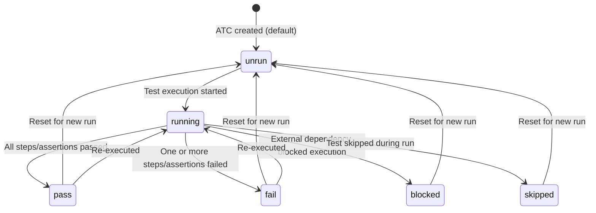
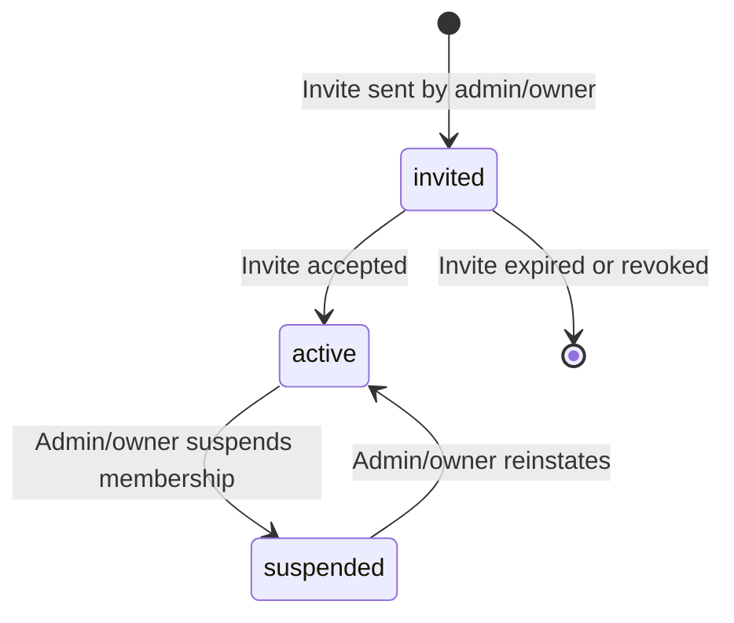
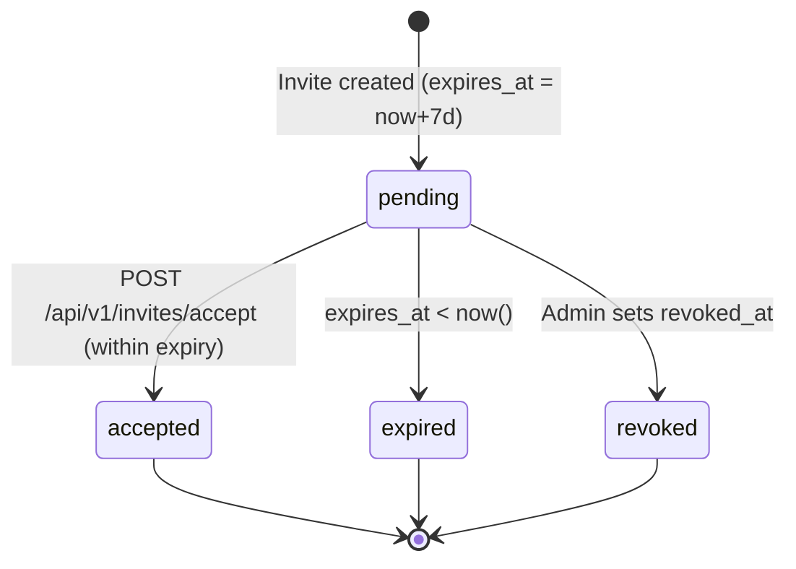

# Domain Glossary — Bunkai

> Last updated: 2026-05-31
> Source of truth: `supabase/migrations/0001–0012` (authoritative schema)
> Companion: `lib/types.ts` (TypeScript mirror — may lag migrations; migrations win on conflicts)

---

## 1. Core Entities

### Workspace

| Field | Value |
|-------|-------|
| Technical Name | `workspace` / `workspaces` |
| Business Name | Workspace / Organization |
| Description | The multi-tenant root boundary. Every piece of data in Bunkai is scoped to a workspace. Users can belong to multiple workspaces with different roles. |
| Table | `public.workspaces` |
| Key Attributes | `id` (UUID PK), `slug` (unique URL identifier), `name`, `owner_user_id` (FK → auth.users), `plan` (`community`/`cloud`/`enterprise`), `created_at` |
| Found In | `supabase/migrations/0001_tenancy.sql`, `lib/types.ts:16–23` |

**Relationships:**
- Has many `workspace_members` (team members)
- Has many `projects`
- Has many `access_tokens` (workspace-scoped PATs)
- Has many `workspace_invites`
- Has many `feature_flags` (workspace-scoped flags)
- Has many `activity_log` entries
- Has many `idempotency_keys`

**JSON example** (from `lib/types.ts`):
```json
{
  "id": "550e8400-e29b-41d4-a716-446655440000",
  "slug": "upex-qa",
  "name": "UPEX QA Team",
  "owner_user_id": "auth-user-uuid",
  "plan": "community",
  "created_at": "2026-05-19T10:00:00Z"
}
```

---

### WorkspaceMember

| Field | Value |
|-------|-------|
| Technical Name | `workspace_member` / `workspace_members` |
| Business Name | Team Member / Membership |
| Description | RBAC join table. A user only has access to a workspace's data when an active membership row exists. The primary authorization gate for all RLS policies. |
| Table | `public.workspace_members` |
| Key Attributes | `workspace_id` (FK), `user_id` (FK → auth.users), `role` (viewer/member/admin/owner), `status` (active/invited/suspended), `joined_at` |
| Found In | `supabase/migrations/0001_tenancy.sql:35–44`, `lib/types.ts:25–31` |

**Relationships:**
- Belongs to `workspace`
- Belongs to `auth.users` (Supabase Auth user)

**JSON example:**
```json
{
  "workspace_id": "workspace-uuid",
  "user_id": "auth-user-uuid",
  "role": "member",
  "status": "active",
  "joined_at": "2026-05-20T09:00:00Z"
}
```

---

### Project

| Field | Value |
|-------|-------|
| Technical Name | `project` / `projects` |
| Business Name | Project / Application Under Test |
| Description | Represents an application or system being tested. Scoped to a single workspace. Contains modules, user stories, and ATCs. |
| Table | `public.projects` |
| Key Attributes | `id` (UUID PK), `workspace_id` (FK), `slug` (unique within workspace), `name`, `description` (nullable), `created_at` |
| Found In | `supabase/migrations/0002_projects_modules.sql:14–23`, `lib/types.ts:33–39` |

**Relationships:**
- Belongs to `workspace`
- Has many `modules`
- Has many `atcs` (via modules)

**JSON example:**
```json
{
  "id": "project-uuid",
  "workspace_id": "workspace-uuid",
  "slug": "bunkai-tms",
  "name": "Bunkai TMS",
  "description": "The Bunkai test management system itself",
  "created_at": "2026-05-19T10:00:00Z"
}
```

---

### Module

| Field | Value |
|-------|-------|
| Technical Name | `module` / `modules` |
| Business Name | Module / Test Suite Folder |
| Description | A self-referential tree node (max depth 6) that organizes user stories and ATCs hierarchically within a project. The `path` column is a materialized slash-separated string (e.g., `auth/login/magic-link`). |
| Table | `public.modules` |
| Key Attributes | `id` (UUID PK), `project_id` (FK), `parent_module_id` (FK → modules, self-referential, nullable), `path` (unique within project, max 6 segments), `name`, `position` (ordering), `created_at` |
| Found In | `supabase/migrations/0002_projects_modules.sql:45–65`, `lib/types.ts:41–49` |

**Relationships:**
- Belongs to `project`
- Belongs to `module` (parent, optional)
- Has many `modules` (children)
- Has many `user_stories`

**JSON example:**
```json
{
  "id": "module-uuid",
  "project_id": "project-uuid",
  "parent_module_id": null,
  "path": "auth",
  "name": "Authentication",
  "position": 0,
  "created_at": "2026-05-19T10:00:00Z"
}
```

---

### UserStory

| Field | Value |
|-------|-------|
| Technical Name | `user_story` / `user_stories` |
| Business Name | User Story / Feature Story |
| Description | The unit of business intent anchored to a Module. Each user story has N sortable Acceptance Criteria. ATCs must reference at least one AC from their linked story (the anchoring moat). |
| Table | `public.user_stories` |
| Key Attributes | `id` (UUID PK), `module_id` (FK), `title`, `description` (nullable), `external_id` (nullable — Jira/GitHub issue ID), `external_url` (nullable — link to external tracker), `created_at` |
| Found In | `supabase/migrations/0003_authoring.sql:13–21`, `lib/types.ts:51–59` |

**Relationships:**
- Belongs to `module`
- Has many `acceptance_criteria`
- Has many `atcs` (via `atc_acceptance_criteria` M:N)

**JSON example:**
```json
{
  "id": "story-uuid",
  "module_id": "module-uuid",
  "title": "As a user, I can log in with my email using a magic link",
  "description": "No password required. Supabase OTP flow.",
  "external_id": "BK-3",
  "external_url": "https://upexgalaxy67.atlassian.net/browse/BK-3",
  "created_at": "2026-05-19T10:00:00Z"
}
```

---

### AcceptanceCriterion

| Field | Value |
|-------|-------|
| Technical Name | `acceptance_criterion` / `acceptance_criteria` |
| Business Name | Acceptance Criterion (AC) |
| Description | A single testable condition that must be met for a User Story to be considered done. ACs have a sortable position within their story. Every ATC must reference at least one AC (the anchoring moat). |
| Table | `public.acceptance_criteria` |
| Key Attributes | `id` (UUID PK), `user_story_id` (FK), `title`, `description` (nullable), `position` (unique within story), `created_at` |
| Found In | `supabase/migrations/0003_authoring.sql:55–68`, `lib/types.ts:61–68` |

**Relationships:**
- Belongs to `user_story`
- Referenced by many `atcs` (via `atc_acceptance_criteria` M:N)

**JSON example:**
```json
{
  "id": "ac-uuid",
  "user_story_id": "story-uuid",
  "title": "User receives magic-link email within 60 seconds",
  "description": "Email contains a one-time link valid for 1 hour",
  "position": 0,
  "created_at": "2026-05-19T10:00:00Z"
}
```

---

### ATC (Acceptance Test Case)

| Field | Value |
|-------|-------|
| Technical Name | `atc` / `atcs` |
| Business Name | Acceptance Test Case (ATC) |
| Description | The core product entity. A structured test case anchored to a Project + Module + UserStory, classified by layer (UI/API/Unit), with a status, tags, full-text search vector, steps, and assertions. Must reference at least one Acceptance Criterion. |
| Table | `public.atcs` |
| Key Attributes | `id` (UUID PK), `project_id` (FK), `module_id` (FK), `user_story_id` (FK, RESTRICT on delete), `slug` (unique within project), `title`, `layer` (UI/API/Unit), `version` (increments on every save), `status` (pass/fail/blocked/skipped/running/unrun), `tags` (text[]), `tsv` (tsvector, GIN-indexed), `created_at`, `updated_at` |
| Found In | `supabase/migrations/0004_atcs.sql:29–51`, `lib/types.ts:74–88` |

**Relationships:**
- Belongs to `project`
- Belongs to `module`
- Belongs to `user_story`
- Has many `atc_steps`
- Has many `atc_assertions`
- References many `acceptance_criteria` (via `atc_acceptance_criteria` M:N)

**JSON example:**
```json
{
  "id": "atc-uuid",
  "project_id": "project-uuid",
  "module_id": "module-uuid",
  "user_story_id": "story-uuid",
  "slug": "ATC-001",
  "title": "Magic link login sends confirmation email",
  "layer": "UI",
  "version": 3,
  "status": "pass",
  "tags": ["auth", "magic-link", "smoke"],
  "created_at": "2026-05-19T10:00:00Z",
  "updated_at": "2026-05-31T08:00:00Z"
}
```

---

### AtcStep

| Field | Value |
|-------|-------|
| Technical Name | `atc_step` / `atc_steps` |
| Business Name | Test Step |
| Description | A single ordered action in an ATC. Has optional `input_data` (test data for the step) and `expected` (expected outcome). Position-ordered within the ATC. |
| Table | `public.atc_steps` |
| Key Attributes | `id` (UUID PK), `atc_id` (FK), `position` (unique within ATC), `content` (step description), `input_data` (nullable), `expected` (nullable) |
| Found In | `supabase/migrations/0004_atcs.sql:77–88`, `lib/types.ts:89–97` |

**Relationships:**
- Belongs to `atc`

---

### AtcAssertion

| Field | Value |
|-------|-------|
| Technical Name | `atc_assertion` / `atc_assertions` |
| Business Name | Test Assertion |
| Description | A single verifiable assertion within an ATC. Position-ordered. Distinct from steps — assertions are the conditions checked, steps are the actions taken. |
| Table | `public.atc_assertions` |
| Key Attributes | `id` (UUID PK), `atc_id` (FK), `position` (unique within ATC), `content` |
| Found In | `supabase/migrations/0004_atcs.sql:102–110`, `lib/types.ts:99–103` |

**Relationships:**
- Belongs to `atc`

---

### AtcAcceptanceCriterion (M:N)

| Field | Value |
|-------|-------|
| Technical Name | `atc_acceptance_criterion` / `atc_acceptance_criteria` |
| Business Name | ATC–AC Link / Anchoring |
| Description | The "anchoring moat" junction table. Links ATCs to the Acceptance Criteria they test. An ATC must reference at least one AC — this is enforced at the application layer in MVP. |
| Table | `public.atc_acceptance_criteria` |
| Key Attributes | `atc_id` (FK + PK component), `acceptance_criterion_id` (FK + PK component) |
| Found In | `supabase/migrations/0004_atcs.sql:130–136`, `lib/types.ts:105–108` |

**Relationships:**
- Belongs to `atc`
- Belongs to `acceptance_criterion`

---

### AccessToken (PAT)

| Field | Value |
|-------|-------|
| Technical Name | `access_token` / `access_tokens` |
| Business Name | Personal Access Token (PAT) |
| Description | Bearer token for headless/CLI/AI-agent API access. Format: `bk_pat_<prefix>.<secret>`. The secret is never stored — only its SHA-256 hash (in sibling table `access_token_secrets`). Revoked via `revoked_at` (soft delete). |
| Table | `public.access_tokens` |
| Key Attributes | `id` (UUID PK), `user_id` (FK), `workspace_id` (FK, nullable — null = global), `name` (nullable label), `token_prefix` (first 12 chars, indexed), `scopes` (text[], from allowed set), `expires_at` (nullable), `revoked_at` (nullable), `last_used_at`, `created_at` |
| Found In | `supabase/migrations/0008_access_tokens.sql`, `lib/api/pat.ts` |

**Relationships:**
- Belongs to `auth.users`
- Optionally scoped to `workspace`
- Has one `access_token_secret` (sibling table for hash)

---

### WorkspaceInvite

| Field | Value |
|-------|-------|
| Technical Name | `workspace_invite` / `workspace_invites` |
| Business Name | Workspace Invitation |
| Description | An admin/owner sends an invite to an email+role. The invitee redeems it via a token embedded in the accept URL. Token hash is stored in sibling table `workspace_invite_secrets` (never the raw token). Expires after 7 days. |
| Table | `public.workspace_invites` |
| Key Attributes | `id` (UUID PK), `workspace_id` (FK), `email`, `role` (viewer/member/admin), `invited_by_user_id` (FK, nullable), `created_at`, `expires_at` (default now+7d), `accepted_at` (nullable), `accepted_by_user_id` (nullable), `revoked_at` (nullable) |
| Found In | `supabase/migrations/0010_workspace_invites.sql` |

**Relationships:**
- Belongs to `workspace`
- Issued by `auth.users`
- Accepted by `auth.users`
- Has one `workspace_invite_secret` (sibling table)

---

### Cross-Cutting Entities

| Entity | Table | Purpose | Found In |
|--------|-------|---------|----------|
| IdempotencyKey | `public.idempotency_keys` | POST replay protection; 24h TTL; unique by (user_id, endpoint, key) | `supabase/migrations/0009_cross_cutting.sql` |
| ActivityLog | `public.activity_log` | Workspace audit trail; written by service_role only | `supabase/migrations/0009_cross_cutting.sql` |
| FeatureFlag | `public.feature_flags` | Gradual rollout gating; global or workspace-scoped | `supabase/migrations/0009_cross_cutting.sql` |
| UserViewState | `public.user_view_state` | Per-user UI state persistence (view preferences per project) | `supabase/migrations/0009_cross_cutting.sql` |
| MagicLinkToken | `public.magic_link_tokens` | Replay-guard audit for magic-link issuances | `supabase/migrations/0009_cross_cutting.sql` |

#### Secret sibling tables (service_role only — QA roles revoked)

| Table | Secrets | Purpose |
|-------|---------|---------|
| `public.access_token_secrets` | `hash` | SHA-256 of the PAT secret |
| `public.magic_link_token_secrets` | `token_hash`, `ip_hash` | Hash of magic-link token + client IP |
| `public.workspace_invite_secrets` | `token_hash` | SHA-256 of invite token |

Source: `supabase/migrations/0011_split_token_secrets.sql`

---

## 2. Enumerations and Constants

### WorkspacePlan

| Value | Business Meaning | Usage Context |
|-------|-----------------|---------------|
| `community` | Free tier (default) | `workspaces.plan` DEFAULT — all new workspaces start here |
| `cloud` | Paid cloud tier | `workspaces.plan` |
| `enterprise` | Self-hosted or enterprise contract | `workspaces.plan` |

Source: `supabase/migrations/0001_tenancy.sql` (CHECK constraint), `lib/types.ts:12`

---

### MemberRole

| Value | Business Meaning | Usage Context |
|-------|-----------------|---------------|
| `viewer` | Read-only access — cannot create/modify anything | `workspace_members.role`, `workspace_invites.role` |
| `member` | Standard collaborator — can create/edit ATCs, stories, modules | `workspace_members.role`, `workspace_invites.role` |
| `admin` | Team manager — can invite members, manage workspace | `workspace_members.role`, `workspace_invites.role` |
| `owner` | Workspace creator — full control including delete workspace | `workspace_members.role` (note: not available in invites — you can't invite someone as owner) |

Source: `supabase/migrations/0001_tenancy.sql` (CHECK constraint), `lib/types.ts:13`

---

### MemberStatus

| Value | Business Meaning | Usage Context |
|-------|-----------------|---------------|
| `active` | Full membership — user can access workspace data | `workspace_members.status` — the RLS gate |
| `invited` | Pending invite acceptance | `workspace_members.status` |
| `suspended` | Access revoked but membership record preserved | `workspace_members.status` |

Source: `supabase/migrations/0001_tenancy.sql` (CHECK constraint), `lib/types.ts:14`

---

### AtcLayer

| Value | Business Meaning | Usage Context |
|-------|-----------------|---------------|
| `UI` | Browser-facing test — validates the user interface | `atcs.layer` — maps to `--layer-ui` (#8b6df0) in design system |
| `API` | API-level test — validates REST/RPC contracts | `atcs.layer` — maps to `--layer-api` (#4f8cf7) |
| `Unit` | Unit-level test — validates isolated business logic | `atcs.layer` — maps to `--layer-unit` (#2fb673) |

Source: `supabase/migrations/0004_atcs.sql` (CHECK constraint), `lib/types.ts:71`, `DESIGN.md §3.6`

---

### AtcStatus

| Value | Business Meaning | Usage Context |
|-------|-----------------|---------------|
| `unrun` | Test not yet executed (default) | `atcs.status` DEFAULT |
| `running` | Test currently executing | `atcs.status` — animated blue dot in UI |
| `pass` | Test passed | `atcs.status` — green signal |
| `fail` | Test failed | `atcs.status` — red signal |
| `blocked` | Test blocked by external dependency | `atcs.status` — amber signal |
| `skipped` | Test deliberately skipped | `atcs.status` — grey signal |

Source: `supabase/migrations/0004_atcs.sql` (CHECK constraint), `lib/types.ts:72`, `DESIGN.md §3.5`

---

### AccessTokenScope

| Value | Business Meaning | Usage Context |
|-------|-----------------|---------------|
| `atc:read` | Read ATCs, steps, assertions, modules, user stories, AC | `access_tokens.scopes` |
| `atc:write` | Create / update / delete ATCs | `access_tokens.scopes` |
| `run:execute` | Start runs + post step results (Phase 2 feature) | `access_tokens.scopes` |
| `workspace:admin` | Manage members, invites, workspace metadata | `access_tokens.scopes` |

Source: `supabase/migrations/0008_access_tokens.sql` (CHECK constraint), `lib/api/pat.ts:13–18`, `app/qa/qa-config.ts` patScopes

---

### IdempotencyKeyStatus

| Value | Business Meaning | Usage Context |
|-------|-----------------|---------------|
| `pending` | Request received, processing | `idempotency_keys.status` DEFAULT |
| `succeeded` | Request completed successfully | `idempotency_keys.status` |
| `failed` | Request failed | `idempotency_keys.status` |

Source: `supabase/migrations/0009_cross_cutting.sql`

---

### FeatureFlagScope

| Value | Business Meaning | Usage Context |
|-------|-----------------|---------------|
| `global` | Flag applies to the entire application | `feature_flags.scope` |
| `workspace` | Flag overrides global at workspace level | `feature_flags.scope` |

Source: `supabase/migrations/0009_cross_cutting.sql`

---

### Reserved Workspace Slugs (constants)

The following slugs cannot be used as workspace identifiers (they shadow Next.js app routes):

`admin`, `api`, `app`, `auth`, `docs`, `invites`, `login`, `logout`, `onboarding`, `projects`, `public`, `qa`, `settings`, `static`, `workspaces`, `_next`

Source: `app/api/v1/workspaces/route.ts` (RESERVED_SLUGS Set)

---

## 3. Business Rules

### BR-001: ATC Anchoring Moat

**Description:** Every ATC must be linked to at least one Acceptance Criterion via the `atc_acceptance_criteria` M:N table. An ATC cannot exist without justification.

**Entities Affected:** `atcs`, `atc_acceptance_criteria`, `acceptance_criteria`

**Validation:** Enforced at the application layer in MVP (editor requires AC selection before save). Structural enforcement pending (FK exists; min-1 constraint is app-layer for now).

**Error Message:** Implicit — the ATC editor's `AnchoringPanel` component does not allow saving without selecting at least one AC.

**Found In:** `supabase/migrations/0004_atcs.sql` (comment: "the anchoring moat"), `components/atcs/AnchoringPanel.tsx`

**Given/When/Then:**
```
Given: A user is creating an ATC with title, layer, steps, and assertions
When: They attempt to save without selecting any Acceptance Criterion
Then: The save is blocked — the ATC is not persisted
```

---

### BR-002: Workspace Slug Uniqueness and Format

**Description:** Workspace slugs must be globally unique, 3–40 chars, lowercase alphanumeric + hyphens, no leading/trailing hyphens, and not reserved.

**Entities Affected:** `workspaces`

**Validation:** Zod schema `CreateBodySchema` with custom `.refine()` rules + DB UNIQUE constraint on `workspaces.slug`.

**Error Message:** "Slug must be lowercase letters/digits/hyphens, 3–40 chars, no edge hyphen." / "Slug is reserved." / 409 "Slug is already taken."

**Found In:** `app/api/v1/workspaces/route.ts:18–29`

**Given/When/Then:**
```
Given: A user creates a workspace with slug "login"
When: The API validates the request
Then: 422 Validation Failed — "Slug is reserved."

Given: A user creates a workspace with slug "my-team"
When: Another workspace with the same slug already exists
Then: 409 Conflict — "Slug 'my-team' is already taken."
```

---

### BR-003: Module Depth Constraint

**Description:** Module tree depth is capped at 6 levels (path has maximum 6 slash-separated segments).

**Entities Affected:** `modules`

**Validation:** DB CHECK constraint `modules_path_depth_max_6` — `array_length(string_to_array(path, '/'), 1) between 1 and 6`.

**Error Message:** DB constraint violation if violated.

**Found In:** `supabase/migrations/0002_projects_modules.sql:57`

**Given/When/Then:**
```
Given: A module tree at depth 6 (path = "a/b/c/d/e/f")
When: A user tries to create a child module (depth 7)
Then: Database rejects the INSERT — constraint violation
```

---

### BR-004: Magic-Link Auth is Passwordless

**Description:** The primary login flow uses Supabase magic-link (OTP email). Users by default have no password. Headless/QA access requires provisioning a password via `POST /api/v1/auth/signup` first.

**Entities Affected:** `magic_link_tokens`, auth flow

**Validation:** N/A — this is a flow constraint, not a DB constraint.

**Error Message:** N/A (flow branches at login page)

**Found In:** `app/qa/qa-config.ts` (signinSnippet, hybridBridge), `app/api/v1/auth/magic-link/route.ts`

**Given/When/Then:**
```
Given: A new QA bot user needs headless API access
When: They call POST /api/v1/auth/signin without first calling /auth/signup
Then: 401 Unauthorized — user exists but has no password
```

---

### BR-005: PAT Token Shown Once

**Description:** The raw PAT secret (`bk_pat_<prefix>.<secret>`) is returned exactly once in the API response. After that, only the token's metadata (id, name, scopes, expiry) is accessible. The SHA-256 hash is stored in `access_token_secrets` which QA/analytics roles cannot read.

**Entities Affected:** `access_tokens`, `access_token_secrets`

**Validation:** Application-layer by design — only the insert response returns the raw secret.

**Found In:** `lib/api/pat.ts` (MintedPat return), `supabase/migrations/0011_split_token_secrets.sql`

**Given/When/Then:**
```
Given: A user mints a PAT via POST /api/v1/tokens
When: They call GET /api/v1/tokens to list their tokens
Then: Token secrets are NOT returned — only id, name, scopes, expiry, last_used_at
```

---

### BR-006: Workspace Invite Expires in 7 Days

**Description:** Workspace invites expire 7 days after creation. The accepting user must follow the invite link before expiry.

**Entities Affected:** `workspace_invites`

**Validation:** DB DEFAULT `(now() + interval '7 days')` on `expires_at`. Application validates on accept.

**Found In:** `supabase/migrations/0010_workspace_invites.sql:12`

**Given/When/Then:**
```
Given: An invite was created 8 days ago
When: The invitee attempts to accept via POST /api/v1/invites/accept
Then: 422 Validation Failed — invite has expired
```

---

### BR-007: RBAC Write Gate (viewer = read-only)

**Description:** `viewer` role members can only SELECT data. All mutations (INSERT, UPDATE, DELETE) require role `member`, `admin`, or `owner`. This is enforced at the DB RLS policy level.

**Entities Affected:** All workspace-scoped tables

**Validation:** RLS policies on all tables check `wm.role in ('member','admin','owner')` for mutations.

**Found In:** `supabase/migrations/0001_tenancy.sql` through `0012` (all mutation policies)

**Given/When/Then:**
```
Given: A workspace member with role 'viewer'
When: They attempt to create an ATC via POST /api/v1/atcs
Then: Supabase RLS returns 0 rows affected → API returns 403
```

---

## 4. Entity Relationships Diagram

```mermaid
erDiagram
    WORKSPACES {
        uuid id PK
        text slug UK
        text name
        uuid owner_user_id FK
        text plan
        timestamptz created_at
    }

    WORKSPACE_MEMBERS {
        uuid workspace_id FK
        uuid user_id FK
        text role
        text status
        timestamptz joined_at
    }

    PROJECTS {
        uuid id PK
        uuid workspace_id FK
        text slug
        text name
        text description
        timestamptz created_at
    }

    MODULES {
        uuid id PK
        uuid project_id FK
        uuid parent_module_id FK
        text path
        text name
        int position
        timestamptz created_at
    }

    USER_STORIES {
        uuid id PK
        uuid module_id FK
        text title
        text description
        text external_id
        text external_url
        timestamptz created_at
    }

    ACCEPTANCE_CRITERIA {
        uuid id PK
        uuid user_story_id FK
        text title
        text description
        int position
        timestamptz created_at
    }

    ATCS {
        uuid id PK
        uuid project_id FK
        uuid module_id FK
        uuid user_story_id FK
        text slug UK
        text title
        text layer
        int version
        text status
        text[] tags
        tsvector tsv
        timestamptz created_at
        timestamptz updated_at
    }

    ATC_STEPS {
        uuid id PK
        uuid atc_id FK
        int position
        text content
        text input_data
        text expected
    }

    ATC_ASSERTIONS {
        uuid id PK
        uuid atc_id FK
        int position
        text content
    }

    ATC_ACCEPTANCE_CRITERIA {
        uuid atc_id FK
        uuid acceptance_criterion_id FK
    }

    ACCESS_TOKENS {
        uuid id PK
        uuid user_id FK
        uuid workspace_id FK
        text name
        text token_prefix
        text[] scopes
        timestamptz expires_at
        timestamptz revoked_at
        timestamptz last_used_at
        timestamptz created_at
    }

    ACCESS_TOKEN_SECRETS {
        uuid token_id PK FK
        text hash
    }

    WORKSPACE_INVITES {
        uuid id PK
        uuid workspace_id FK
        text email
        text role
        uuid invited_by_user_id FK
        timestamptz expires_at
        timestamptz accepted_at
        uuid accepted_by_user_id FK
        timestamptz revoked_at
    }

    WORKSPACE_INVITE_SECRETS {
        uuid invite_id PK FK
        text token_hash
    }

    WORKSPACES ||--o{ WORKSPACE_MEMBERS : "has members"
    WORKSPACES ||--o{ PROJECTS : "contains"
    WORKSPACES ||--o{ ACCESS_TOKENS : "scopes"
    WORKSPACES ||--o{ WORKSPACE_INVITES : "issues"
    PROJECTS ||--o{ MODULES : "organizes"
    MODULES ||--o{ MODULES : "parent of"
    MODULES ||--o{ USER_STORIES : "contains"
    USER_STORIES ||--o{ ACCEPTANCE_CRITERIA : "has"
    ATCS }o--|| PROJECTS : "belongs to"
    ATCS }o--|| MODULES : "filed under"
    ATCS }o--|| USER_STORIES : "tests"
    ATCS ||--o{ ATC_STEPS : "has steps"
    ATCS ||--o{ ATC_ASSERTIONS : "has assertions"
    ATCS ||--o{ ATC_ACCEPTANCE_CRITERIA : "anchors to"
    ACCEPTANCE_CRITERIA ||--o{ ATC_ACCEPTANCE_CRITERIA : "anchored by"
    ACCESS_TOKENS ||--|| ACCESS_TOKEN_SECRETS : "secret in"
    WORKSPACE_INVITES ||--|| WORKSPACE_INVITE_SECRETS : "secret in"
```

---

## 5. Terminology Mapping

### Technical → Business Terms

| Code Term | Business Term | Notes |
|-----------|--------------|-------|
| `workspace` | Workspace / Organization | Multi-tenant root boundary |
| `workspace_member` | Team Member | User belonging to a workspace |
| `project` | Project / Application Under Test | The system being tested |
| `module` | Module / Test Suite Folder | Hierarchical container for stories/ATCs |
| `user_story` | User Story / Feature Story | Unit of business intent |
| `acceptance_criterion` (AC) | Acceptance Criterion (AC) | Single testable condition for a story |
| `atc` | Acceptance Test Case (ATC) | Core test entity |
| `atc_step` | Test Step | Action in a test case |
| `atc_assertion` | Test Assertion | Condition checked in a test case |
| `atc_acceptance_criteria` | ATC–AC Link / Anchoring | The "anchoring moat" junction |
| `access_token` | Personal Access Token (PAT) | Headless API key |
| `workspace_invite` | Workspace Invitation | Team onboarding mechanism |
| `layer` | Test Layer | UI / API / Unit classification |
| `status` | Test Status | pass / fail / blocked / skipped / running / unrun |
| `tsv` | Full-Text Search Vector | GIN-indexed tsvector for ATC search |
| `slug` | URL Identifier | Human-readable unique ID |
| `plan` | Workspace Plan / Tier | community / cloud / enterprise |
| `role` | Member Role | viewer / member / admin / owner |
| `bunkai_save_atc` | Save ATC (atomic RPC) | Single-transaction ATC save including children |

### Abbreviations and Acronyms

| Abbreviation | Full Form | Context |
|-------------|-----------|---------|
| ATC | Acceptance Test Case | Core Bunkai entity |
| AC | Acceptance Criterion | Test justification anchor |
| PAT | Personal Access Token | `bk_pat_<prefix>.<secret>` format |
| RLS | Row-Level Security | PostgreSQL tenant isolation mechanism |
| RBAC | Role-Based Access Control | viewer/member/admin/owner permission system |
| GIN | Generalized Inverted Index | PostgreSQL index type used for full-text search on `atcs.tsv` |
| TMS | Test Management System | What Bunkai is |
| RPC | Remote Procedure Call | Supabase/PostgREST stored function calls |
| OTP | One-Time Password | Supabase magic-link mechanism |
| BK | Bunkai (Jira project key) | Used in Jira ticket IDs (BK-3, BK-29, etc.) |

---

## 6. Status / State Flows

### ATC Status Flow



Source: `supabase/migrations/0004_atcs.sql` (CHECK constraint on `status`), `lib/types.ts:72`, `DESIGN.md §3.5`

---

### WorkspaceMember Status Flow



Source: `supabase/migrations/0001_tenancy.sql` (CHECK constraint on `status`)

---

### WorkspaceInvite Lifecycle



Source: `supabase/migrations/0010_workspace_invites.sql`

---

### Access Token Lifecycle

```mermaid
stateDiagram-v2
    [*] --> active : Token minted (POST /api/v1/tokens or auth/signup or auth/signin)
    active --> active : Used in API call (last_used_at updated)
    active --> revoked : DELETE /api/v1/tokens/{id} → sets revoked_at
    active --> expired : expires_at < now() (if expires_at set)
    revoked --> [*] : Soft-deleted (row preserved for audit)
    expired --> [*] : Rejected by middleware; row preserved
```



Source: `supabase/migrations/0008_access_tokens.sql`, `lib/api/pat.ts`

---

## 7. UI Labels Reference

No i18n files found. UI labels are in component JSX/TSX. Key testable UI labels (from `app/qa/qa-config.ts`):

### Login Form (magic-link)

| data-testid | Label / Purpose |
|-------------|----------------|
| `login-email` | Email input for magic-link send |
| `login-submit` | "Send magic link" button |

Expected post-submit state: text matching `/check your inbox/i` becomes visible.

Source: `app/qa/qa-config.ts` playwright.loginTestIds

---

## 8. Discovery Gaps

- [ ] **ATC run reporting** — `run:execute` scope exists but no `runs` or `run_results` tables/endpoints found; test execution results persistence is a planned feature (Phase 2 per `app/qa/qa-config.ts`)
- [ ] **External story sync** — `user_stories.external_id` and `external_url` suggest Jira/GitHub issue linking but no sync endpoint/webhook found
- [ ] **Feature flag UI** — `feature_flags` table with global/workspace scope exists but no admin UI or API endpoint found; managed via Supabase Studio in MVP
- [ ] **Activity log reader** — `activity_log` table exists but no read API endpoint found for workspace members
- [ ] **User profile / `me` full schema** — `GET /api/v1/me` exists but the Profile entity (display name, avatar, preferences) is not reflected in a DB table — Supabase Auth `auth.users` metadata is used
- [ ] **Workspace settings screen** — `app/(app)/workspaces/[id]/members/page.tsx` exists but full workspace settings (rename, plan upgrade, delete) UI not confirmed
- [ ] **ATC slug format** — `atcs.slug` is unique within project but the generation convention (ATC-001 vs custom) is not enforced at DB level; only app-layer convention
- [ ] **`user_view_state.view_kind` values** — column exists but no enum/CHECK constraint; valid values not determinable from code alone

---

## 9. QA Usage Guide

This glossary is the authoritative reference for all test-case authoring in Bunkai. Use it as follows:

- **Test case naming**: use `ATC` (not TC or Test) when referring to test cases. Use the slug format `ATC-XXX` matching `atcs.slug`.
- **Layer selection**: always classify ATCs as `UI`, `API`, or `Unit` — never use synonyms like "E2E" or "integration" in the `layer` field.
- **AC anchoring**: every test case written for Bunkai must itself reference the Acceptance Criteria it verifies — modeling the product's own requirement.
- **Status vocabulary**: use exact status values (`pass`, `fail`, `blocked`, `skipped`, `running`, `unrun`) in test reports — do not substitute synonyms.
- **Role-based test design**: design separate test cases for the `viewer` (read-only) and `member`/`admin`/`owner` (write) permission boundaries. Cross-tenant RLS isolation requires at least one dedicated test per entity type.
- **Auth flows**: the magic-link flow is passwordless — do NOT try to verify OTP tokens in browser tests. Use `login-email` + `login-submit` testids and assert the "Check your inbox" confirmation state. For API tests, use the signup/signin PAT bootstrap path.
- **PAT scopes**: scope each PAT used in tests to the minimum required — do not use `workspace:admin` for read-only tests.
- **Multi-tenancy probes**: every sprint should include at least one cross-tenant isolation test — login as User B and attempt to read User A's workspace data; expect 0 rows.
