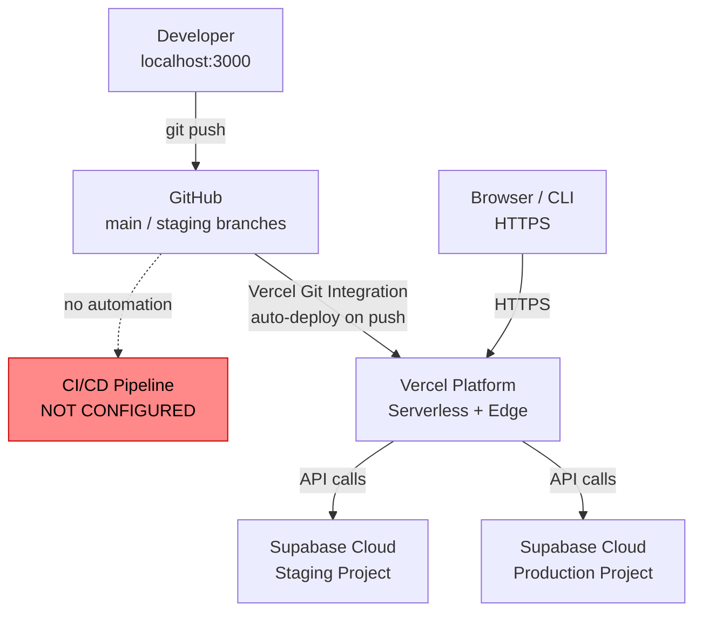

# Infrastructure Mapping

> Product: Bunkai TMS
> Phase: 3 — Infrastructure Discovery
> Generated: 2026-05-31
> Source of truth: `lib/urls.ts`, `.agents/project.yaml`, `dbhub.toml`, `.env.example`, `package.json`

---

## 1. Overview Diagram

```
+------------------+     push      +------------------+     build+deploy     +-------------------+
|   Developer      |  ---------->  |   GitHub         |  (manual/Vercel Git  |   Vercel          |
|   localhost:3000 |               |   main branch    |   integration)  ---> |   (serverless)    |
+------------------+               +------------------+                       +-------------------+
         |                                                                              |
         | bun run dev                                                                  | HTTPS
         |                                                                              |
         v                                                                              v
+------------------+                                                          +-------------------+
|  Local Supabase  |                                                          |  Supabase Cloud   |
|  (Docker, CLI)   |   <-- no supabase/config.toml found -- gap -->          |  (staging + prod) |
+------------------+                                                          +-------------------+

CI/CD:  NONE CONFIGURED (no .github/workflows/, no .gitlab-ci.yml, no other CI signal files)
IaC:    NONE CONFIGURED (no Terraform, Pulumi, CDK, Serverless Framework detected)
```

---

## 2. Deployment Diagram (Mermaid)



---

## 3. CI/CD Configuration

**Status: ABSENT — confirmed**

| Signal file checked | Result |
|--------------------|--------|
| `.github/workflows/` directory | Does not exist |
| `.gitlab-ci.yml` | Does not exist |
| `azure-pipelines.yml` | Does not exist |
| `.circleci/config.yml` | Does not exist |
| `Jenkinsfile` | Does not exist |

Source: `ls /Users/micaela/Desktop/projects/upex/upex-bunkai-tms/.github/` → `NO .github DIR`

**No automated CI pipeline exists.** There are no:
- Automated lint/typecheck runs on pull request
- Automated build validation
- Automated E2E or integration test runs
- Branch protection rules enforced by CI

**What exists instead**:
- Husky pre-commit hooks (`prepare: husky`) — run `lint-staged` on staged files
- `bun run repo:check` script — manual quality gate (format + lint + types + vars + skills)
- Manual deploy via Vercel Git integration (push → Vercel auto-builds)

---

## 4. Deployment Configuration

| Property | Value | Source |
|----------|-------|--------|
| Platform | Vercel | `.agents/project.yaml`, `lib/urls.ts` |
| Deploy method | Vercel Git Integration (auto-deploy on push) | Platform behavior — no `vercel.json` found |
| `vercel.json` | Not found | Root directory listing |
| `Dockerfile` | Not found | Root directory listing |
| `docker-compose.yml` | Not found | Root directory listing |
| Framework preset | Next.js (Vercel auto-detects) | `next.config.ts` presence |
| Build command | `next build` (Vercel default for Next.js) | `package.json` scripts.build |
| Output | Default serverless functions + static assets | `next.config.ts` — no `standalone` output |
| Preview deployments | Yes — Vercel creates a preview URL for every push to non-production branches | Vercel platform default |
| Region | Unknown (not specified in `vercel.json` — file absent) | Discovery Gap |

---

## 5. Environments Matrix

| Environment | URL | Branch | Auto Deploy | Approval | Database |
|-------------|-----|--------|-------------|----------|---------|
| Development | `http://localhost:3000` | (local) | — | — | Local Supabase (Docker) |
| Preview | `<commit-hash>-upex-bunkai.vercel.app` (pattern) | Any PR / non-main push | Yes (Vercel) | None | Unknown — likely staging Supabase |
| Staging | `https://staging-upexbunkai.vercel.app` | `staging` (inferred) | Yes (Vercel) | None | Supabase staging project |
| Production | `https://upexbunkai.vercel.app` | `main` | Yes (Vercel) | Unknown | Supabase production project |

Source: `lib/urls.ts:9–13`, `.agents/project.yaml`

> **Note on preview environments**: Vercel preview deployment URLs are dynamic per-commit (`<hash>-<project>.vercel.app`). Do NOT hardcode preview URLs in Playwright tests — use the Vercel CLI or API to fetch the latest preview URL for the current PR.

> **Note on staging branch**: The `staging` branch name is inferred from `lib/urls.ts` mapping `VERCEL_ENV === 'preview'` → staging environment. Actual branch-to-environment configuration lives in the Vercel dashboard, not in the repo.

---

## 6. Environment Variables by Environment

| Variable | Development | Staging | Production | Notes |
|----------|-------------|---------|-----------|-------|
| `NEXT_PUBLIC_APP_URL` | `http://localhost:3000` | `https://staging-upexbunkai.vercel.app` | `https://upexbunkai.vercel.app` | Must be set in Vercel env vars per environment |
| `NEXT_PUBLIC_SUPABASE_URL` | Local Supabase project URL | Staging Supabase project URL | Production Supabase project URL | Different project per env |
| `NEXT_PUBLIC_SUPABASE_ANON_KEY` | Local anon key | Staging anon key | Production anon key | Different per project |
| `SUPABASE_SERVICE_ROLE_KEY` | Local service-role key | Staging service-role key | Production service-role key | **Server-only** — never expose |
| `SUPABASE_JWT_SECRET` | Local JWT secret (optional) | Staging JWT secret | Production JWT secret | Optional until JWT features ship |
| `VERCEL_ENV` | (absent) | `preview` (injected by Vercel) | `production` (injected by Vercel) | Vercel system var — not in `.env` |

---

## 7. Secrets Management

| Secret | Storage Location | Access Scope | Notes |
|--------|-----------------|-------------|-------|
| `SUPABASE_SERVICE_ROLE_KEY` | Vercel environment variables (staging + prod) | Server-only runtime | Bypasses RLS — never expose to browser |
| `NEXT_PUBLIC_SUPABASE_ANON_KEY` | Vercel environment variables + `.env` (local) | Browser-safe | Exposed in client bundle by design |
| `NEXT_PUBLIC_SUPABASE_URL` | Vercel environment variables + `.env` (local) | Browser-safe | Supabase project ref in URL |
| `SUPABASE_JWT_SECRET` | Vercel environment variables | Server-only | For custom JWT signing |
| `ATLASSIAN_API_TOKEN` | `.env` only (local) | Developer machine | QA tooling only — never deployed to Vercel |
| `TAVILY_API_KEY` | `.env` only (local) | Developer machine + Claude MCP | QA tooling |
| `RESEND_API_KEY` | `.env` only (local) | Developer machine | Email testing |
| `SUPABASE_ACCESS_TOKEN` | `.env` only (local) | Developer machine | Supabase MCP control plane |
| PAT tokens (`bk_pat_*`) | SHA-256 hash in `access_token_secrets` table | DB (server-only — QA roles BYPASSRLS but cannot read this table) | `supabase/migrations/0011` |
| Invite tokens | SHA-256 hash in `workspace_invite_secrets` table | Same as PAT | `supabase/migrations/0011` |
| DBHub credentials (`DBHUB_*`) | `.env` only (local) | QA machine only | Credentials from Jira Epic BK-29 |

> **Rotation cadence**: Not documented. No secret rotation tooling (Vault, Doppler, 1Password CLI) detected.

---

## 8. Cloud Services

| Service | Provider | Tier | Purpose | Integration |
|---------|----------|------|---------|-------------|
| PostgreSQL 17 | Supabase | Cloud managed | Primary application database | `@supabase/supabase-js` SDK |
| Auth | Supabase Auth | Included in Supabase | Magic-link OTP, email/password, JWT sessions | `supabase.auth.*` methods |
| Email (magic-link) | Supabase Auth SMTP | Included in Supabase | Sends OTP email for magic-link flow | Via `signInWithOtp()` |
| Hosting + CDN | Vercel | Pro or Hobby | Next.js serverless deployment, edge functions, CDN | Vercel Git Integration |
| Email (transactional) | Resend (unconfirmed) | External | Transactional email — NOT yet wired in app code | `RESEND_API_KEY` in `.env.example` only; MVP uses `console.log` for invite URL |
| Issue tracking | Jira Cloud (upexgalaxy67.atlassian.net) | External | QA backlog, bug reports | QA tooling only — no in-product integration |

Source: `lib/env.ts`, `package.json`, `app/api/v1/workspaces/[id]/invites/route.ts` comment

---

## 9. Database Infrastructure

| Property | Value | Source |
|----------|-------|--------|
| Provider | Supabase managed | `lib/env.ts` SUPABASE_URL format |
| Engine | PostgreSQL 17 | `supabase/migrations/` |
| Region | Unknown — not specified in code | Discovery Gap |
| Connection pooling | Supabase PgBouncer (transaction pooler, port 6543) available | `.env.example` POSTGRES_URL |
| Session pooler | Port 5432 — required for DBHub MCP (prepared statements) | `dbhub.toml` comment |
| Backups | Managed by Supabase (platform default) | Supabase platform behavior |
| RLS | Enabled on all tables | `supabase/migrations/0001–0012` |
| QA access roles | `qa_inspector_ro` (SELECT, BYPASSRLS), `qa_inspector_rw` (SELECT/INSERT/UPDATE/DELETE, BYPASSRLS) | `app/qa/qa-config.ts` (Phase 1 finding) |
| Admin access | Service-role key bypasses RLS entirely | `lib/supabase/admin.ts` |
| Local dev | Supabase CLI (Docker-based local stack) — `supabase start` | `supabase/` directory |

> **Local stack gap**: `supabase/config.toml` not found in target repo. `supabase start` requires this file. Run `supabase init` to generate it before running local migrations.

---

## 10. Infrastructure Resources Diagram

```mermaid
graph LR
    subgraph Vercel["Vercel (Serverless + Edge)"]
        NextJS["Next.js App<br/>App Router + API Routes"]
        MW["Middleware<br/>(Edge Runtime)"]
    end

    subgraph Supabase["Supabase Cloud"]
        DB["PostgreSQL 17<br/>(RLS enabled)"]
        Auth["Supabase Auth<br/>(magic-link + session)"]
    end

    Browser["Browser / CLI"] -->|HTTPS| MW
    MW -->|session check| Auth
    MW -->|pass or redirect| NextJS
    NextJS -->|anon client (RLS)| DB
    NextJS -->|admin client (service-role)| DB
    NextJS -->|signInWithOtp / signInWithPassword| Auth
    Auth -->|OTP email| Email["Email Inbox (SMTP)"]

    QA["QA Machine<br/>(bunkai-qa-engineering)"] -->|HTTPS + PAT Bearer| NextJS
    QA -->|DBHub MCP<br/>port 5432| DB
```

---

## 11. IaC (Infrastructure as Code)

**Status: None detected**

| Tool | Signal file | Found |
|------|------------|-------|
| Terraform | `*.tf` files | No |
| Pulumi | `Pulumi.yaml` | No |
| AWS CDK | `cdk.json` | No |
| Serverless Framework | `serverless.yml` | No |
| Docker | `Dockerfile`, `docker-compose.yml` | No |

All infrastructure (Vercel hosting, Supabase cloud) is managed via the respective vendor dashboards. No IaC tooling is in use.

---

## 12. Monitoring & Observability

**Status: None configured in the codebase**

| Tool | Status | Evidence |
|------|--------|---------|
| Sentry | Not installed | Absent from `package.json` |
| Datadog | Not installed | Absent from `package.json` |
| BetterStack / UptimeRobot | Not configured | No config files detected |
| Rollbar / Bugsnag | Not installed | Absent from `package.json` |
| `web-vitals` | Not installed | Absent from `package.json` |
| Structured logging | Implemented — JSON to stdout (Vercel) | `lib/api/logging.ts` — captured by Vercel's log drain |
| `x-request-id` header | Propagated on every API response | `lib/api/request-id.ts`, `lib/api/handler.ts:43` |

**Effective observability**: Vercel log output (from `lib/api/logging.ts` JSON logs) and `x-request-id` header correlation. No error tracking, no uptime monitoring, no APM/metrics pipeline.

---

## 13. Deployment Checklist

### Pre-Deploy

- [ ] Run `bun run repo:check` — format + lint + types + vars + skills all pass
- [ ] Run `bun run openapi:diff` — confirm no unintentional API contract changes
- [ ] Verify all required env vars set in Vercel dashboard for target environment
- [ ] Check `NEXT_PUBLIC_APP_URL` is set to correct deployed URL in Vercel
- [ ] Run DB migrations if any new `.sql` files in `supabase/migrations/`: `supabase db push --project-ref <ref>`
- [ ] Smoke test staging with `GET https://staging-upexbunkai.vercel.app/api/v1/health`

### Post-Deploy

- [ ] Verify health endpoint: `GET /api/v1/health` returns `{ ok: true, env: "production" }`
- [ ] Verify magic-link flow works end-to-end (email delivery, OTP exchange, session cookie set)
- [ ] Verify PAT Bearer auth: `GET /api/v1/me` with a valid token returns 200
- [ ] Verify `/api/docs` (Scalar UI) renders the OpenAPI spec

### Rollback

Vercel provides instant rollback:

```bash
# List recent deployments
vercel deployments list --project upex-bunkai-tms

# Promote a previous deployment to production
vercel rollback <deployment-url-or-id>
```

No database migration rollback tooling detected. Schema rollbacks require a new forward migration.

---

## 14. Discovery Gaps

| Gap | Severity | Impact | Recommendation |
|-----|----------|--------|---------------|
| **No CI/CD pipeline** | High | No automated lint/typecheck on PRs; no automated test gate before merge; Vercel deploys code that may have type errors | Add GitHub Actions workflow with: `bun run repo:check` + (future) Playwright E2E tests |
| **No monitoring or error tracking** | High | Silent production errors; no alerting on failures or downtime | Add Sentry for error tracking; Vercel Analytics or BetterStack for uptime |
| **`supabase/config.toml` missing** | Medium | `supabase start` cannot run locally — local DB development blocked | Run `supabase init` in target repo; commit `config.toml` |
| **No staging branch documented** | Medium | Branch-to-environment mapping is inferred from Vercel config, not in repo | Document in `docs/` or `CLAUDE.md`; confirm with team |
| **Vercel region unknown** | Low | Cannot verify DB latency or select optimal region for QA tests | Check Vercel dashboard → Project → Settings → Regions |
| **Preview environment DB unknown** | Medium | PR preview deployments likely hit staging Supabase — test data from PRs may pollute staging | Confirm in Vercel dashboard; consider separate preview Supabase project |
| **No secret rotation cadence** | Medium | No documented process for rotating `SUPABASE_SERVICE_ROLE_KEY` or PAT tokens | Document rotation procedure; consider Doppler or Vercel's built-in env sync |
| **Rollback is Vercel-only** | Medium | DB migrations have no rollback — forward-only schema changes | Establish migration rollback convention (new down migration files) |
| **No `.github/` directory at all** | High | Not just CI — no GitHub Actions, no Dependabot, no PR templates, no CODEOWNERS | Add `.github/` directory with basic workflow + PR template |

---

## 15. QA Relevance

### Environment Access for Playwright

| Environment | Access Method | Auth Required |
|-------------|-------------|--------------|
| Staging | `https://staging-upexbunkai.vercel.app` | Email/password via `POST /api/v1/auth/signin` → PAT |
| Production | `https://upexbunkai.vercel.app` | Read-only QA access |
| Local | `http://localhost:3000` + `supabase start` | Local dev credentials |

### QA Setup Steps

```bash
# 1. Provision QA bot user (first time only — returns PAT)
curl -s -X POST https://staging-upexbunkai.vercel.app/api/v1/auth/signup \
  -H "Content-Type: application/json" \
  -d '{"email":"qa.bot@bunkai-test.dev","password":"<from-bk-29>"}' \
  | jq '.pat.token'

# 2. Verify QA access
curl -s https://staging-upexbunkai.vercel.app/api/v1/health
# Expected: {"ok":true,"service":"bunkai-tms","env":"staging","ts":"..."}

# 3. Set PAT in QA repo .env
# BUNKAI_PAT=bk_pat_<prefix>.<secret>
```

### CI Integration (Once GitHub Actions Is Added)

Recommended GitHub Actions workflow for QA integration:

```yaml
# Suggested: .github/workflows/qa.yml (to be created)
name: QA
on: [push, pull_request]
jobs:
  check:
    runs-on: ubuntu-latest
    steps:
      - uses: actions/checkout@v4
      - uses: oven-sh/setup-bun@v2
      - run: bun install
      - run: bun run repo:check   # format + lint + types + vars + skills

  e2e:
    runs-on: ubuntu-latest
    needs: check
    steps:
      - uses: actions/checkout@v4
      # Run Playwright E2E from bunkai-qa-engineering against staging URL
      # (staging URL is available via VERCEL_URL or hardcoded staging URL)
```

### Test Isolation Notes

- Staging Supabase is a shared environment — tests must clean up created data or use unique identifiers
- No `supabase/seed.sql` — cannot reset DB to a clean baseline automatically
- PAT tokens are revocable via `DELETE /api/v1/tokens/<id>` — QA can create/revoke tokens per test suite run
- `Idempotency-Key` header support on POST operations — E2E tests can replay safely
